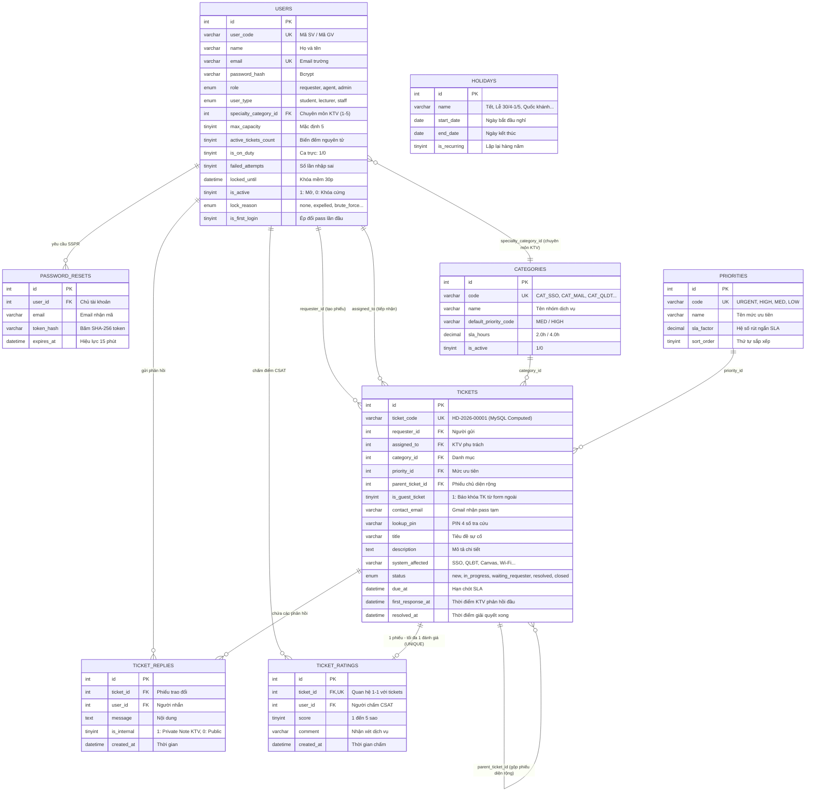

# TRƯỜNG ĐẠI HỌC THỦ ĐÔ HÀ NỘI
### KHOA CÔNG NGHỆ THÔNG TIN · BÀI TẬP LỚN LẬP TRÌNH WEB (NHÓM 1)
---
# 📊 TÀI LIỆU THIẾT KẾ CƠ SỞ DỮ LIỆU (ERD) & HỆ THỐNG MÃ MÀU ĐỒNG BỘ UI

> **Chủ đề 9:** Hệ thống Helpdesk CNTT Trực tuyến Trường Đại học (IT Support Online)  
> **Tập tin SQL DDL:** [`database/schema.sql`](database/schema.sql)  
> **Tập tin SQL Seeders:** [`database/seed.sql`](database/seed.sql)  
> **Nhóm thực hiện:** Nhóm 1 (Phạm Thị Thanh Ngân, Trần Thục Linh, Lê Hà My, Nguyễn Ánh Nhi, Phan Công Thành)

---

## 🎨 PHẦN 1: HỆ THỐNG MÃ MÀU ĐỒNG BỘ GIAO DIỆN (UI COLOR DESIGN SYSTEM)

Để toàn bộ 5 thành viên trong nhóm thiết kế giao diện (HTML/CSS, các trang Sinh viên, Giảng viên, KTV và Admin Dashboard) đồng nhất 100%, nhóm lựa chọn hệ màu chủ đạo: **"Thudo Metropolitan Blue & Modern Slate"** (Hiện đại, uy tín, chuẩn phong cách IT Service Desk doanh nghiệp).

### 1. Bảng tra cứu Mã màu Chuẩn (Hex & RGB)

| Nhóm Màu | Tên Token | Mã HEX | Giá trị RGB | Ứng dụng cụ thể trong Giao diện |
|---|---|:---:|:---:|---|
| **Chủ đạo (Primary)** | `--color-primary` | `#0284c7` | `rgb(2, 132, 199)` | Màu nút bấm chính, thanh tiêu đề bảng, liên kết nổi bật, logo thương hiệu |
| **Chủ đạo đậm (Dark)**| `--color-primary-dark` | `#0369a1` | `rgb(3, 105, 161)` | Trạng thái Hover của nút bấm, đường viền phân cách tiêu đề `h1`, menu đang chọn |
| **Chủ đạo nhạt (Light)**| `--color-primary-light`| `#e0f2fe` | `rgb(224, 242, 254)`| Nền badge trạng thái `new`, nền khối thông báo nổi bật, highlight dòng bảng |
| **Nền tối (Sidebar/Nav)**| `--color-navy-dark` | `#0f172a` | `rgb(15, 23, 42)` | Nền thanh điều hướng Navbar, Sidebar Menu, nền thẻ Code/Console |
| **Nền trang (Body Bg)** | `--color-bg-body` | `#f8fafc` | `rgb(248, 250, 252)`| Nền tổng thể trang web (giúp giảm mỏi mắt so với nền trắng tinh) |
| **Nền khối (Card Bg)** | `--color-bg-card` | `#ffffff` | `rgb(255, 255, 255)`| Nền thẻ Dashboard, bàn làm việc KTV, Form gửi phiếu |
| **Viền (Border)** | `--color-border` | `#cbd5e1` | `rgb(203, 213, 225)`| Viền ô nhập liệu (Input), viền bảng, viền đường chia mục |
| **Chữ chính (Text Main)**| `--color-text-main` | `#1e293b` | `rgb(30, 41, 59)` | Màu văn bản chính, tiêu đề bài viết, nội dung phiếu |
| **Chữ phụ (Text Muted)**| `--color-text-muted` | `#64748b` | `rgb(100, 116, 139)`| Chữ chú thích, thời gian gửi, nhãn placeholder |

### 2. Hệ màu Trạng thái Nghiệp vụ (Semantic Status Colors)

| Trạng thái Nghiệp vụ | Mã Token CSS | Mã HEX (Text/Border) | Mã HEX (Nền Background) | Ý nghĩa hiển thị trên Giao diện |
|---|---|:---:|:---:|---|
| **Mới tạo (New)** | `--status-new` | `#0284c7` | `#e0f2fe` | Phiếu mới gửi, đang chờ hệ thống tiếp nhận |
| **Đang xử lý (In Progress)**| `--status-progress`| `#d97706` | `#fffbeb` | KTV đang khắc phục, đồng hồ SLA đang đếm ngược |
| **Chờ SV/GV (Waiting)** | `--status-waiting` | `#7c3aed` | `#f5f3ff` | KTV đã gửi pass tạm/hướng dẫn, **SLA tạm dừng** |
| **Đã giải quyết (Resolved)**| `--status-resolved`| `#16a34a` | `#f0fdf4` | Đã xong kỹ thuật, chờ sinh viên nghiệm thu CSAT |
| **Đã đóng (Closed)** | `--status-closed` | `#475569` | `#f1f5f9` | Phiếu hoàn tất hoặc tự đóng sau 72 giờ |
| **Khẩn cấp (Urgent / Alert)**| `--status-danger` | `#dc2626` | `#fef2f2` | Sự cố khẩn cấp giờ thi, cờ đỏ quá tải hệ thống, tài khoản bị đuổi học |

### 3. Khối mã CSS Tokens dùng chung (Copy vào `public/assets/css/style.css`)

```css
/* ==========================================================================
   HỆ BIẾN MÀU ĐỒNG BỘ TOÀN HỆ THỐNG HELPDESK - ĐẠI HỌC THỦ ĐÔ HÀ NỘI
   ========================================================================== */
:root {
    /* Brand Colors */
    --primary: #0284c7;
    --primary-dark: #0369a1;
    --primary-light: #e0f2fe;
    
    /* Neutral & Layout */
    --navy-dark: #0f172a;
    --bg-body: #f8fafc;
    --bg-card: #ffffff;
    --border-color: #cbd5e1;
    --text-main: #1e293b;
    --text-muted: #64748b;

    /* Semantic Status Badges */
    --badge-new-text: #0284c7;
    --badge-new-bg: #e0f2fe;
    
    --badge-progress-text: #b45309;
    --badge-progress-bg: #fef3c7;
    
    --badge-waiting-text: #7c3aed;
    --badge-waiting-bg: #f5f3ff;
    
    --badge-resolved-text: #15803d;
    --badge-resolved-bg: #dcfce7;
    
    --badge-closed-text: #475569;
    --badge-closed-bg: #f1f5f9;

    --badge-danger-text: #b91c1c;
    --badge-danger-bg: #fee2e2;

    /* Font Family */
    --font-sans: 'Segoe UI', system-ui, -apple-system, sans-serif;
    --font-mono: 'Consolas', 'Courier New', monospace;
}
```

---

## 🗄️ PHẦN 2: SƠ ĐỒ THỰC THỂ LIÊN KẾT (ERD - ENTITY RELATIONSHIP DIAGRAM)

Sơ đồ thể hiện chuẩn 8 bảng trong CSDL với các ràng buộc Khóa chính (PK), Khóa ngoại (FK) và Ràng buộc duy nhất (UNIQUE):



---

## 📑 PHẦN 3: DANH SÁCH BẢNG & TRƯỜNG DỮ LIỆU TỐI THIỂU (DATA DICTIONARY)

Hệ thống chốt danh sách **8 bảng tối thiểu**, chuẩn hóa bậc 3 (3NF), đảm bảo tính toàn vẹn dữ liệu:

### 1. Bảng `categories` (Danh mục dịch vụ số)
| Tên Cột | Kiểu Dữ Liệu | Ràng buộc | Ý nghĩa Nghiệp vụ |
|---|---|---|---|
| `id` | `INT UNSIGNED` | `PRIMARY KEY, AUTO_INCREMENT` | Định danh duy nhất danh mục |
| `code` | `VARCHAR(50)` | `NOT NULL, UNIQUE` | Mã định danh (`CAT_SSO`, `CAT_MAIL`, `CAT_QLDT`, `CAT_CANVAS`, `CAT_WIFI`) |
| `name` | `VARCHAR(100)` | `NOT NULL` | Tên hiển thị nhóm dịch vụ |
| `description` | `VARCHAR(255)` | `NULL` | Mô tả phạm vi hỗ trợ |
| `default_priority_code` | `VARCHAR(20)` | `NOT NULL, DEFAULT 'MED'` | Mức ưu tiên tự động gán cho sinh viên (Auto-Priority) |
| `sla_hours` | `DECIMAL(4,1)` | `NOT NULL, DEFAULT 4.0` | Hạn thời gian giải quyết chuẩn theo ITIL (2.0h hoặc 4.0h) |
| `is_active` | `TINYINT(1)` | `NOT NULL, DEFAULT 1` | Cờ bật/tắt hiển thị danh mục |

### 2. Bảng `priorities` (Mức độ ưu tiên)
| Tên Cột | Kiểu Dữ Liệu | Ràng buộc | Ý nghĩa Nghiệp vụ |
|---|---|---|---|
| `id` | `INT UNSIGNED` | `PRIMARY KEY, AUTO_INCREMENT` | Định danh mức ưu tiên |
| `code` | `VARCHAR(20)` | `NOT NULL, UNIQUE` | `URGENT` (Khẩn cấp), `HIGH` (Cao), `MED` (Trung bình), `LOW` (Thấp) |
| `name` | `VARCHAR(50)` | `NOT NULL` | Tên hiển thị mức độ ưu tiên |
| `sla_factor` | `DECIMAL(3,2)` | `NOT NULL, DEFAULT 1.00` | Hệ số rút ngắn SLA (URGENT = 0.25, HIGH = 0.50, MED = 1.00) |
| `sort_order` | `TINYINT UNSIGNED`| `NOT NULL, DEFAULT 1` | Thứ tự hiển thị ưu tiên |

### 3. Bảng `users` (Tài khoản người dùng toàn trường)
| Tên Cột | Kiểu Dữ Liệu | Ràng buộc | Ý nghĩa Nghiệp vụ |
|---|---|---|---|
| `id` | `INT UNSIGNED` | `PRIMARY KEY, AUTO_INCREMENT` | Định danh người dùng |
| `user_code` | `VARCHAR(30)` | `NOT NULL, UNIQUE` | Mã Sinh viên (`224001736`) hoặc Mã Giảng viên / KTV |
| `name` | `VARCHAR(100)` | `NOT NULL` | Họ và tên đầy đủ |
| `email` | `VARCHAR(190)` | `NOT NULL, UNIQUE` | Email trường học (`@daihocthudo.edu.vn`) |
| `password_hash` | `VARCHAR(255)` | `NOT NULL` | Mật khẩu băm Bcrypt an toàn một chiều |
| `role` | `ENUM(...)` | `NOT NULL, DEFAULT 'requester'`| Vai trò hệ thống: `requester` (SV/GV), `agent` (KTV), `admin` (Quản trị) |
| `user_type` | `ENUM(...)` | `NOT NULL, DEFAULT 'student'`| Phân loại: `student` (Sinh viên), `lecturer` (Giảng viên), `staff` (Cán bộ) |
| `department` | `VARCHAR(100)` | `NULL` | Khoa đào tạo / Phòng ban công tác |
| `phone` | `VARCHAR(20)` | `NULL` | Số điện thoại liên lạc |
| `specialty_category_id`| `INT UNSIGNED`| `NULL, FK -> categories(id)` | Nhóm sự cố chuyên sâu của KTV (1 đến 5 phục vụ Skill-based Routing) |
| `max_capacity` | `TINYINT UNSIGNED`| `NOT NULL, DEFAULT 5` | Ngưỡng tiếp nhận tối đa cùng lúc của KTV (chống quá tải) |
| `active_tickets_count`| `TINYINT UNSIGNED`| `NOT NULL, DEFAULT 0` | Bộ đếm nguyên tử số phiếu đang xử lý của KTV |
| `is_on_duty` | `TINYINT(1)` | `NOT NULL, DEFAULT 1` | Trạng thái ca trực của KTV: 1 (Đang trực), 0 (Nghỉ ca) |
| `failed_attempts` | `TINYINT UNSIGNED`| `NOT NULL, DEFAULT 0` | Đếm số lần gõ sai mật khẩu liên tiếp |
| `locked_until` | `DATETIME` | `NULL` | Mốc thời gian kết thúc Khóa mềm (30 phút) |
| `is_active` | `TINYINT(1)` | `NOT NULL, DEFAULT 1` | Trạng thái tài khoản: 1 (Hoạt động), 0 (Khóa cứng) |
| `lock_reason` | `ENUM(...)` | `NOT NULL, DEFAULT 'none'` | Lý do khóa: `none`, `brute_force`, `violation`, `expelled` (đuổi học) |
| `is_first_login` | `TINYINT(1)` | `NOT NULL, DEFAULT 1` | Bắt buộc đổi mật khẩu ở lần đầu đăng nhập |

### 4. Bảng `holidays` (Danh mục ngày nghỉ lễ trường học)
| Tên Cột | Kiểu Dữ Liệu | Ràng buộc | Ý nghĩa Nghiệp vụ |
|---|---|---|---|
| `id` | `INT UNSIGNED` | `PRIMARY KEY, AUTO_INCREMENT` | Định danh ngày lễ |
| `name` | `VARCHAR(100)` | `NOT NULL` | Tên dịp nghỉ lễ (Tết, 30/4 - 1/5, Quốc khánh 2/9...) |
| `start_date` | `DATE` | `NOT NULL` | Ngày bắt đầu nghỉ |
| `end_date` | `DATE` | `NOT NULL` | Ngày kết thúc nghỉ |
| `is_recurring` | `TINYINT(1)` | `NOT NULL, DEFAULT 0` | 1 nếu là ngày lễ cố định hàng năm |

### 5. Bảng `password_resets` (Mã khôi phục mật khẩu SSPR)
| Tên Cột | Kiểu Dữ Liệu | Ràng buộc | Ý nghĩa Nghiệp vụ |
|---|---|---|---|
| `id` | `INT UNSIGNED` | `PRIMARY KEY, AUTO_INCREMENT` | Định danh phiên reset |
| `user_id` | `INT UNSIGNED` | `NOT NULL, FK -> users(id)` | Tài khoản cần khôi phục |
| `email` | `VARCHAR(190)` | `NOT NULL` | Hòm thư nhận link khôi phục |
| `token_hash` | `VARCHAR(64)` | `NOT NULL` | Chuỗi băm SHA-256 của token bí mật gửi qua mail |
| `expires_at` | `DATETIME` | `NOT NULL` | Thời hạn hết hiệu lực (15 phút) |

### 6. Bảng `tickets` (Phiếu yêu cầu hỗ trợ trực tuyến)
| Tên Cột | Kiểu Dữ Liệu | Ràng buộc | Ý nghĩa Nghiệp vụ |
|---|---|---|---|
| `id` | `INT UNSIGNED` | `PRIMARY KEY, AUTO_INCREMENT` | Khóa chính tăng tự động |
| `ticket_code` | `VARCHAR(30)` | `GENERATED ALWAYS AS ..., UNIQUE`| Mã định dạng `HD-2026-00001` sinh tự động bởi MySQL 8 |
| `requester_id` | `INT UNSIGNED` | `NOT NULL, FK -> users(id)` | Người gửi phiếu |
| `assigned_to` | `INT UNSIGNED` | `NULL, FK -> users(id)` | KTV được phân công xử lý |
| `category_id` | `INT UNSIGNED` | `NOT NULL, FK -> categories(id)` | Nhóm sự cố (1 đến 5) |
| `priority_id` | `INT UNSIGNED` | `NOT NULL, FK -> priorities(id)` | Mức độ ưu tiên thực tế |
| `parent_ticket_id`| `INT UNSIGNED` | `NULL, FK -> tickets(id)` | Phiếu chủ khi gộp sự cố diện rộng LMS/QLĐT |
| `is_guest_ticket` | `TINYINT(1)` | `NOT NULL, DEFAULT 0` | 1: Gửi từ form công khai khi bị khóa tài khoản |
| `contact_email` | `VARCHAR(190)` | `NULL` | Gmail cá nhân ngoài trường nhận pass tạm |
| `lookup_pin` | `VARCHAR(10)` | `NULL` | Mã PIN 4 số tra cứu không cần login |
| `title` | `VARCHAR(150)` | `NOT NULL` | Tiêu đề tóm tắt sự cố |
| `description` | `TEXT` | `NOT NULL` | Mô tả chi tiết hiện tượng lỗi |
| `system_affected`| `VARCHAR(50)` | `NOT NULL` | Hệ thống bị lỗi: SSO, QLĐT, Canvas, Mail, Wi-Fi |
| `status` | `ENUM(...)` | `NOT NULL, DEFAULT 'new'` | `new`, `in_progress`, `waiting_requester`, `resolved`, `closed` |
| `due_at` | `DATETIME` | `NOT NULL` | Hạn chót hoàn thành theo SLA giờ hành chính |
| `first_response_at`| `DATETIME` | `NULL` | Thời điểm KTV gửi phản hồi đầu tiên (First Response Time) |
| `resolved_at` | `DATETIME` | `NULL` | Thời điểm KTV hoàn tất kỹ thuật |
| `closed_at` | `DATETIME` | `NULL` | Thời điểm người dùng nghiệm thu hoặc tự đóng sau 72h |

### 7. Bảng `ticket_replies` (Trao đổi trong phiếu)
| Tên Cột | Kiểu Dữ Liệu | Ràng buộc | Ý nghĩa Nghiệp vụ |
|---|---|---|---|
| `id` | `INT UNSIGNED` | `PRIMARY KEY, AUTO_INCREMENT` | Định danh tin nhắn |
| `ticket_id` | `INT UNSIGNED` | `NOT NULL, FK -> tickets(id)` | Thuộc phiếu nào |
| `user_id` | `INT UNSIGNED` | `NOT NULL, FK -> users(id)` | Người gửi tin |
| `message` | `TEXT` | `NOT NULL` | Nội dung phản hồi / hướng dẫn |
| `is_internal` | `TINYINT(1)` | `NOT NULL, DEFAULT 0` | 1: Ghi chú nội bộ bí mật (chỉ KTV/Admin thấy), 0: Công khai |
| `created_at` | `DATETIME` | `NOT NULL, DEFAULT CURRENT_TIMESTAMP` | Thời điểm gửi tin |

### 8. Bảng `ticket_ratings` (Đánh giá chất lượng CSAT)
| Tên Cột | Kiểu Dữ Liệu | Ràng buộc | Ý nghĩa Nghiệp vụ |
|---|---|---|---|
| `id` | `INT UNSIGNED` | `PRIMARY KEY, AUTO_INCREMENT` | Định danh đánh giá |
| `ticket_id` | `INT UNSIGNED` | `NOT NULL, UNIQUE, FK -> tickets(id)`| Quan hệ 1-1 (Mỗi phiếu chỉ được chấm điểm 1 lần) |
| `user_id` | `INT UNSIGNED` | `NOT NULL, FK -> users(id)` | Chủ phiếu chấm điểm |
| `score` | `TINYINT UNSIGNED`| `NOT NULL, CHECK (score BETWEEN 1 AND 5)`| Điểm độ hài lòng từ 1 đến 5 sao |
| `comment` | `VARCHAR(500)` | `NULL` | Nhận xét chi tiết về thái độ & tốc độ của KTV |

---

## 🚀 PHẦN 4: HƯỚNG DẪN THỰC THI SCRIPT CƠ SỞ DỮ LIỆU

### Cách 1: Thực thi qua giao diện đồ họa phpMyAdmin (XAMPP)
1. Mở trình duyệt, truy cập `http://localhost/phpmyadmin`.
2. Tạo CSDL mới tên: **`helpdesk_thudo`** (chọn bảng mã Collation: `utf8mb4_unicode_ci`).
3. Chọn cơ sở dữ liệu `helpdesk_thudo` vừa tạo ở cột bên trái.
4. Bấm vào tab **Import** (Nhập):
   * Bước 1: Chọn file `database/schema.sql` → Bấm nút **Import** ở cuối trang để tạo cấu trúc 8 bảng.
   * Bước 2: Chọn tiếp file `database/seed.sql` → Bấm nút **Import** để nạp dữ liệu mẫu.

### Cách 2: Thực thi qua Dòng lệnh MySQL (Command Line / PowerShell)
Mở cửa sổ PowerShell hoặc Terminal tại thư mục gốc dự án và chạy 2 lệnh sau:

```bash
# 1. Chạy file tạo bảng (schema.sql)
mysql -u root -p helpdesk_thudo < database/schema.sql

# 2. Chạy file nạp dữ liệu mẫu (seed.sql)
mysql -u root -p helpdesk_thudo < database/seed.sql
```

### Câu lệnh Kiểm tra Nhanh sau khi Nạp CSDL thành công:
```sql
USE helpdesk_thudo;

-- Kiểm tra danh sách 8 bảng
SHOW TABLES;

-- Kiểm tra dữ liệu KTV và chuyên môn đã gán
SELECT id, user_code, name, email, specialty_category_id, active_tickets_count, is_on_duty 
FROM users WHERE role = 'agent';

-- Kiểm tra các phiếu mẫu và mã tự sinh ticket_code
SELECT id, ticket_code, title, status, due_at FROM tickets;
```

---
*Tài liệu được soạn thảo và chuẩn hóa bởi Nhóm 1 - Bài tập lớn Lập trình Web - Học kỳ I.*

