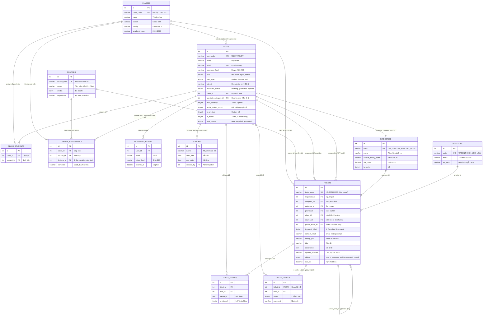

# TRƯỜNG ĐẠI HỌC THỦ ĐÔ HÀ NỘI
### KHOA CÔNG NGHỆ THÔNG TIN · BÀI TẬP LỚN LẬP TRÌNH WEB (NHÓM 1)
---
# 📊 TÀI LIỆU THIẾT KẾ CƠ SỞ DỮ LIỆU (ERD), CƠ CHẾ ĐÀO TẠO & HỆ THỐNG MÃ MÀU UI

> **Chủ đề 9:** Hệ thống Helpdesk CNTT Trực tuyến Trường Đại học (IT Support Online)  
> **Tập tin SQL DDL:** [`database/schema.sql`](database/schema.sql)  
> **Tập tin SQL Seeders:** [`database/seed.sql`](database/seed.sql)  
> **Nhóm thực hiện:** Nhóm 1 (Phạm Thị Thanh Ngân, Trần Thục Linh, Lê Hà My, Nguyễn Ánh Nhi, Phan Công Thành)

---

## 🎨 PHẦN 1: HỆ THỐNG MÃ MÀU ĐỒNG BỘ GIAO DIỆN (UI COLOR DESIGN SYSTEM)

Hệ thống Helpdesk chọn bộ màu chủ đạo **"Thudo Metropolitan Blue & Modern Slate"** (Hiện đại, trang nhã, đúng phong cách Cổng dịch vụ CNTT đại học). Cả nhóm copy trực tiếp đoạn mã CSS biến dùng chung này vào file `public/assets/css/style.css`:

```css
:root {
    /* --- MÀU THƯƠNG HIỆU & NỀN TẢNG --- */
    --primary: #0284c7;        /* Xanh dương chủ đạo (Nút bấm chính, tiêu đề bảng, icon) */
    --primary-dark: #0369a1;   /* Xanh đậm (Khi rê chuột / Hover, thanh Header) */
    --primary-light: #e0f2fe;  /* Xanh nhạt (Nền badge mới, dòng highlight) */
    
    /* --- BỐ CỤC & NỀN GIAO DIỆN --- */
    --navy-dark: #0f172a;      /* Nền thanh Navbar, Sidebar menu, khung Code */
    --bg-body: #f8fafc;        /* Nền tổng thể trang web (giúp giảm mỏi mắt) */
    --bg-card: #ffffff;        /* Nền các thẻ Card, Form gửi phiếu, Bàn làm việc */
    --border-color: #cbd5e1;   /* Màu viền bảng, viền ô nhập liệu (Input) */
    --text-main: #1e293b;      /* Chữ nội dung chính (Đen than dễ đọc) */
    --text-muted: #64748b;     /* Chữ phụ, ngày giờ, nhãn ghi chú */

    /* --- MÀU TRẠNG THÁI NGHIỆP VỤ (SEMANTIC STATUS BADGES) --- */
    --badge-new-text: #0284c7;       --badge-new-bg: #e0f2fe;   /* Phiếu mới tạo (New) */
    --badge-progress-text: #b45309;  --badge-progress-bg: #fef3c7; /* Đang xử lý (In Progress) */
    --badge-waiting-text: #7c3aed;   --badge-waiting-bg: #f5f3ff;  /* Chờ phản hồi (Dừng SLA) */
    --badge-resolved-text: #15803d;  --badge-resolved-bg: #dcfce7; /* Đã giải quyết (Resolved) */
    --badge-closed-text: #475569;    --badge-closed-bg: #f1f5f9;   /* Đã hoàn thành (Closed) */
    --badge-danger-text: #b91c1c;    --badge-danger-bg: #fee2e2;   /* Khẩn cấp / Đuổi học / Báo động đỏ */
}
```

---

## 🏛️ PHẦN 2: ĐẶC TẢ CƠ CHẾ ĐÀO TẠO & VÒNG ĐỜI TÀI KHOẢN (ACADEMIC LIFECYCLE)

### 1. Cơ chế Quản lý Tài khoản Admin (Đầu kỳ & Hết khóa)
* **A. Khởi tạo & Import hàng loạt Đầu kỳ (Bulk User Provisioning):**
  * Admin tiếp nhận file CSV xuất từ Cổng Tuyển sinh & Quản lý Đào tạo vào đầu mỗi năm học / kỳ học.
  * Hệ thống cung cấp công cụ `AdminUserController@importCsv`:
    * **Sinh viên:** Tự động tạo tài khoản (mã định danh `224xxxxxx`, email `@daihocthudo.edu.vn`), gán lớp sinh hoạt (`class_id`), gán khóa (`cohort = 'D24'`), thiết lập `academic_status = 'studying'`, mật khẩu khởi tạo cố định là **`123456`** và bật cờ `is_first_login = 1` bắt buộc đổi mật khẩu lần đầu.
    * **Giảng viên:** Import tài khoản giảng viên, gán bộ môn công tác, mật khẩu khởi tạo mặc định là **`123456`**, phân quyền hỗ trợ học thuật.
    * **Kỹ thuật viên:** Import KTV, mật khẩu khởi tạo **`123456`**, phân bổ nhóm chuyên môn chính (`specialty_category_id` từ 1 đến 5) và hạn mức tải `max_capacity`.
    * **Phân công đào tạo:** Nạp dữ liệu phân công giảng dạy lớp học phần (`course_assignments`).
* **B. Xử lý Sinh viên Hết khóa & Buộc thôi học (Graduation & Expulsion Lifecycle):**
  * **Sinh viên hết khóa (Đã tốt nghiệp):** Admin sử dụng bộ lọc theo khóa tuyển sinh (`cohort`, ví dụ `D20`). Bấm lệnh **"Chuyển trạng thái Tốt nghiệp"**:
    * Cập nhật `academic_status = 'graduated'`, gán `lock_reason = 'graduated'`.
    * Hệ thống tự động thu hồi quyền nộp bài tập trên Canvas LMS, thu hồi license phần mềm nghiên cứu và đóng tài khoản Wi-Fi Ký túc xá, chỉ giữ lại hòm thư cựu sinh viên phục vụ tra cứu văn bằng và bảng điểm điện tử.
  * **Sinh viên thôi học / Đình chỉ học (Expelled):** Admin chọn sinh viên vi phạm $\rightarrow$ Bấm lệnh **"Khóa Cứng Kỷ Luật / Buộc Thôi Học"**:
    * Cập nhật `academic_status = 'expelled'`, `is_active = 0`, `lock_reason = 'expelled'`.
    * Thu hồi token/session ngay lập tức, chặn hoàn toàn tính năng Quên mật khẩu SSPR và hiện cảnh báo đỏ trên bàn làm việc KTV từ chối mở khóa nếu gửi Guest Ticket.

### 2. Cơ chế Phân công Giảng dạy Lớp học phần: 1 Lớp học phần chỉ có 1 Giáo viên phụ trách
Hệ thống thiết kế mô hình đào tạo theo học chế tín chỉ thực tế tại Trường Đại học Thủ Đô Hà Nội (TUD):
* **Quan hệ Lớp - Sinh viên:** Một Lớp sinh hoạt (`classes`, ví dụ `D24-CNTT1` thuộc khóa `D24`) gồm **nhiều Sinh viên** (`class_students`).
* **Quy tắc Lớp học phần:** **Mỗi lớp học phần (1 môn của 1 lớp trong 1 học kỳ) CHỈ CÓ DUY NHẤT 1 GIÁO VIÊN PHỤ TRÁCH**.
  * *Ví dụ thực tế:* Trong 1 học kỳ sinh viên lớp `D24-CNTT1` học 6 môn, tương ứng với **6 lớp học phần** do **6 giảng viên quản lý**:
    1. Lập trình Web (`WEB101`) → **TS. Nguyễn Văn Giảng** phụ trách quản lý danh sách lớp học phần
    2. Mạng máy tính (`NET201`) → **ThS. Trần Thị Hạnh** phụ trách quản lý danh sách lớp học phần
    3. Cơ sở dữ liệu (`DB102`) → **TS. Lê Văn Tuấn** phụ trách quản lý danh sách lớp học phần
    4. Hệ điều hành (`OS101`) → **ThS. Phạm Mai Lan** phụ trách quản lý danh sách lớp học phần
    5. Kỹ nghệ Phần mềm (`SE201`) → **TS. Hoàng Quốc Bảo** phụ trách quản lý danh sách lớp học phần
    6. E-Learning & LMS (`LMS301`) → **ThS. Vũ Thị Ngọc** phụ trách quản lý danh sách lớp học phần
  * Bảng `course_assignments` thiết lập ràng buộc duy nhất: `UNIQUE KEY uq_course_class_semester (class_id, course_id, semester)`. Ràng buộc này đảm bảo chắc chắn không thể phân công trùng hoặc dư giảng viên cho cùng 1 lớp học phần trong kỳ.
* **Ứng dụng vào Phân hệ Helpdesk:**
  * Khi Sinh viên gửi phiếu báo sự cố nhóm LMS Canvas hoặc Cổng QLĐT, hệ thống cho phép chọn trực tiếp **Lớp học (`class_id`)** và **Môn học (`course_id`)** đang bị lỗi.
  * Nhờ đó, KTV 4 (Canvas) khoanh vùng chính xác lớp học phần bị sự cố, đồng thời đúng 1 Giảng viên phụ trách môn học đó của lớp sẽ nhận được thông báo để phối hợp xử lý!

---

## 🗄️ PHẦN 3: SƠ ĐỒ THỰC THỂ LIÊN KẾT (ERD - ENTITY RELATIONSHIP DIAGRAM)

Sơ đồ thể hiện chuẩn 12 bảng trong CSDL với các ràng buộc Khóa chính (PK), Khóa ngoại (FK) và Ràng buộc duy nhất (UNIQUE):



---

## 📑 PHẦN 4: TỪ ĐIỂN DỮ LIỆU TỐI THIỂU (DATA DICTIONARY)

### 1. Bảng `classes` (Lớp học - Khóa TUD D24)
| Tên Cột | Kiểu Dữ Liệu | Ràng buộc | Ý nghĩa Nghiệp vụ |
|---|---|---|---|
| `id` | `INT UNSIGNED` | `PRIMARY KEY, AUTO_INCREMENT` | Định danh lớp |
| `class_code` | `VARCHAR(30)` | `NOT NULL, UNIQUE` | Mã lớp: `D24-CNTT1`, `D24-CNTT2` |
| `name` | `VARCHAR(100)` | `NOT NULL` | Tên lớp: Lớp Công nghệ Thông tin D24-1 |
| `cohort` | `VARCHAR(20)` | `NOT NULL, DEFAULT 'D24'` | Khóa đào tạo: `D24`, `D20` (phục vụ lọc hết khóa) |
| `faculty` | `VARCHAR(100)` | `NOT NULL` | Khoa quản lý: Khoa Công nghệ Thông tin |
| `academic_year`| `VARCHAR(30)` | `NOT NULL, DEFAULT '2024-2028'` | Niên khóa đào tạo: `2024-2028` |

### 2. Bảng `courses` (6 Môn học trong 1 Học kỳ)
| Tên Cột | Kiểu Dữ Liệu | Ràng buộc | Ý nghĩa Nghiệp vụ |
|---|---|---|---|
| `id` | `INT UNSIGNED` | `PRIMARY KEY, AUTO_INCREMENT` | Định danh môn học |
| `course_code` | `VARCHAR(30)` | `NOT NULL, UNIQUE` | Mã môn học: `WEB101`, `NET201`, `DB102`, `OS101`, `SE201`, `LMS301` |
| `name` | `VARCHAR(100)` | `NOT NULL` | Tên môn: Lập trình Web & Ứng dụng |
| `credits` | `TINYINT UNSIGNED`| `NOT NULL, DEFAULT 3` | Số tín chỉ của học phần |
| `department` | `VARCHAR(100)` | `NOT NULL` | Bộ môn phụ trách chuyên môn |

### 3. Bảng `class_students` (Quan hệ 1 Lớp có nhiều Sinh viên)
| Tên Cột | Kiểu Dữ Liệu | Ràng buộc | Ý nghĩa Nghiệp vụ |
|---|---|---|---|
| `id` | `INT UNSIGNED` | `PRIMARY KEY, AUTO_INCREMENT` | Định danh bản ghi |
| `class_id` | `INT UNSIGNED` | `NOT NULL, FK -> classes(id)` | Lớp học |
| `student_id` | `INT UNSIGNED` | `NOT NULL, FK -> users(id)` | Sinh viên thuộc lớp (quan hệ nhiều - 1) |
| Ràng buộc: | `UNIQUE (class_id, student_id)` | Tránh trùng lặp sinh viên trong một lớp |

### 4. Bảng `course_assignments` (Phân công Giảng dạy Lớp học phần: 1 Lớp HP có 1 GV phụ trách)
| Tên Cột | Kiểu Dữ Liệu | Ràng buộc | Ý nghĩa Nghiệp vụ |
|---|---|---|---|
| `id` | `INT UNSIGNED` | `PRIMARY KEY, AUTO_INCREMENT` | Định danh phân công lớp học phần |
| `class_id` | `INT UNSIGNED` | `NOT NULL, FK -> classes(id)` | Lớp sinh hoạt |
| `course_id` | `INT UNSIGNED` | `NOT NULL, FK -> courses(id)` | Môn học (1 trong 6 môn của kỳ) |
| `lecturer_id`| `INT UNSIGNED` | `NOT NULL, FK -> users(id)` | **1 Giáo viên duy nhất phụ trách lớp học phần này** |
| `semester` | `VARCHAR(20)` | `NOT NULL, DEFAULT '2026_1'` | Học kỳ áp dụng phân công |
| `academic_year`| `VARCHAR(20)` | `NOT NULL, DEFAULT '2026-2027'` | Năm học áp dụng |
| Ràng buộc: | `UNIQUE (class_id, course_id, semester)` | **Đảm bảo 1 lớp học phần chỉ có 1 giáo viên phụ trách duy nhất** |

### 5. Bảng `users` (Tài khoản người dùng toàn trường)
| Tên Cột | Kiểu Dữ Liệu | Ràng buộc | Ý nghĩa Nghiệp vụ |
|---|---|---|---|
| `id` | `INT UNSIGNED` | `PRIMARY KEY, AUTO_INCREMENT` | Định danh người dùng |
| `user_code` | `VARCHAR(30)` | `NOT NULL, UNIQUE` | Mã SV (`224001736`) hoặc Mã GV / KTV |
| `name` | `VARCHAR(100)` | `NOT NULL` | Họ và tên đầy đủ |
| `email` | `VARCHAR(190)` | `NOT NULL, UNIQUE` | Email trường học (`@daihocthudo.edu.vn`) |
| `password_hash`| `VARCHAR(255)`| `NOT NULL` | Mật khẩu khởi tạo băm Bcrypt (mặc định: `123456`) |
| `role` | `ENUM(...)` | `NOT NULL, DEFAULT 'requester'`| `requester`, `agent`, `admin` |
| `user_type` | `ENUM(...)` | `NOT NULL, DEFAULT 'student'`| `student`, `lecturer`, `staff` |
| `class_id` | `INT UNSIGNED` | `NULL, FK -> classes(id)` | Lớp sinh hoạt chính của sinh viên |
| `cohort` | `VARCHAR(20)` | `NULL, DEFAULT 'D24'` | Khóa tuyển sinh: `D24` (sinh viên TUD), `D20` (Admin lọc hết khóa) |
| `academic_status`| `ENUM(...)` | `NOT NULL, DEFAULT 'studying'` | Trạng thái: `studying` (đang học), `graduated` (tốt nghiệp), `expelled` (đuổi học) |
| `specialty_category_id`| `INT UNSIGNED`| `NULL, FK -> categories(id)` | Nhóm sự cố chuyên sâu KTV (1 đến 5) |
| `max_capacity`| `TINYINT UNSIGNED`| `NOT NULL, DEFAULT 5` | Ngưỡng tải tối đa của KTV |
| `active_tickets_count`| `TINYINT UNSIGNED`| `NOT NULL, DEFAULT 0` | Bộ đếm nguyên tử số phiếu đang xử lý |
| `is_on_duty` | `TINYINT(1)` | `NOT NULL, DEFAULT 1` | 1: Đang trực, 0: Nghỉ ca |
| `is_active` | `TINYINT(1)` | `NOT NULL, DEFAULT 1` | 1: Hoạt động, 0: Khóa cứng |
| `lock_reason`| `ENUM(...)` | `NOT NULL, DEFAULT 'none'` | `none`, `expelled` (đuổi học), `graduated` (hết khóa) |

### 6. Bảng `tickets` (Phiếu hỗ trợ - Có gắn Môn & Lớp)
| Tên Cột | Kiểu Dữ Liệu | Ràng buộc | Ý nghĩa Nghiệp vụ |
|---|---|---|---|
| `id` | `INT UNSIGNED` | `PRIMARY KEY, AUTO_INCREMENT` | Khóa chính |
| `ticket_code` | `VARCHAR(30)` | `GENERATED ALWAYS AS ..., UNIQUE`| `HD-2026-00001` sinh tự động |
| `requester_id`| `INT UNSIGNED` | `NOT NULL, FK -> users(id)` | Người gửi |
| `assigned_to` | `INT UNSIGNED` | `NULL, FK -> users(id)` | KTV xử lý |
| `category_id` | `INT UNSIGNED` | `NOT NULL, FK -> categories(id)` | Nhóm dịch vụ (1 đến 5) |
| `priority_id` | `INT UNSIGNED` | `NOT NULL, FK -> priorities(id)` | Mức độ ưu tiên |
| `class_id` | `INT UNSIGNED` | `NULL, FK -> classes(id)` | Lớp học phần bị lỗi |
| `course_id` | `INT UNSIGNED` | `NULL, FK -> courses(id)` | Môn học bị lỗi trên Canvas/QLĐT |
| `parent_ticket_id`| `INT UNSIGNED`| `NULL, FK -> tickets(id)` | Gộp phiếu sự cố diện rộng |
| `is_guest_ticket`| `TINYINT(1)` | `NOT NULL, DEFAULT 0` | 1: Báo khóa tài khoản từ form ngoài |
| `contact_email`| `VARCHAR(190)` | `NULL` | Gmail cá nhân nhận pass tạm |
| `lookup_pin` | `VARCHAR(10)` | `NULL` | Mã PIN 4 số tra cứu không cần login |
| `title` | `VARCHAR(150)` | `NOT NULL` | Tiêu đề sự cố |
| `description` | `TEXT` | `NOT NULL` | Chi tiết hiện tượng lỗi |
| `status` | `ENUM(...)` | `NOT NULL, DEFAULT 'new'` | `new`, `in_progress`, `waiting_requester`, `resolved`, `closed` |
| `due_at` | `DATETIME` | `NOT NULL` | Hạn chót SLA giờ hành chính |

---

## 🚀 PHẦN 5: HƯỚNG DẪN CHẠY SCRIPT TẠO CƠ SỞ DỮ LIỆU

1. **Khởi động XAMPP:** Bật dịch vụ **Apache** và **MySQL**.
2. **Import qua phpMyAdmin:**
   * Mở `http://localhost/phpmyadmin` → Tạo CSDL: `helpdesk_thudo` (Collation: `utf8mb4_unicode_ci`).
   * Chọn `helpdesk_thudo` → Tab **Import**:
     * Lần 1: Chọn file [`database/schema.sql`](database/schema.sql) → Bấm **Import**.
     * Lần 2: Chọn file [`database/seed.sql`](database/seed.sql) → Bấm **Import**.
3. **Tài khoản kiểm tra mẫu (Mật khẩu cố định: `123456`):**
   * **Admin:** `admin@daihocthudo.edu.vn` (có menu Import CSV đầu kỳ & lọc hết khóa).
   * **Kỹ thuật viên 1 (SSO):** `ktv1@daihocthudo.edu.vn`
   * **6 Giảng viên phụ trách 6 lớp học phần kỳ 1:**
     * `nguyenvangiang@daihocthudo.edu.vn` (Dạy Lập trình Web `WEB101` lớp `D24-CNTT1`)
     * `tranthihanh@daihocthudo.edu.vn` (Dạy Mạng máy tính `NET201` lớp `D24-CNTT1`)
     * `levantuan@daihocthudo.edu.vn` (Dạy Cơ sở dữ liệu `DB102` lớp `D24-CNTT1`)
     * `phammailan@daihocthudo.edu.vn` (Dạy Hệ điều hành `OS101` lớp `D24-CNTT1`)
     * `hoangquocbao@daihocthudo.edu.vn` (Dạy Kỹ nghệ phần mềm `SE201` lớp `D24-CNTT1`)
     * `vuthingoc@daihocthudo.edu.vn` (Dạy E-Learning & LMS `LMS301` lớp `D24-CNTT1`)
   * **Sinh viên khóa TUD D24 (Lớp D24-CNTT1):**
     * `224001736@daihocthudo.edu.vn` (Phạm Thị Thanh Ngân - Trưởng nhóm)
     * `224001729@daihocthudo.edu.vn` (Trần Thục Linh)
     * `224001737@daihocthudo.edu.vn` (Lê Hà My)
     * `224001742@daihocthudo.edu.vn` (Nguyễn Ánh Nhi)
     * `224001746@daihocthudo.edu.vn` (Phan Công Thành)
   * **Cựu sinh viên hết khóa (D20 tốt nghiệp):** `220001001@daihocthudo.edu.vn` (`graduated`)
   * **Sinh viên TUD D24 bị kỷ luật buộc thôi học:** `224001999@daihocthudo.edu.vn` (`expelled`, Khóa cứng)


