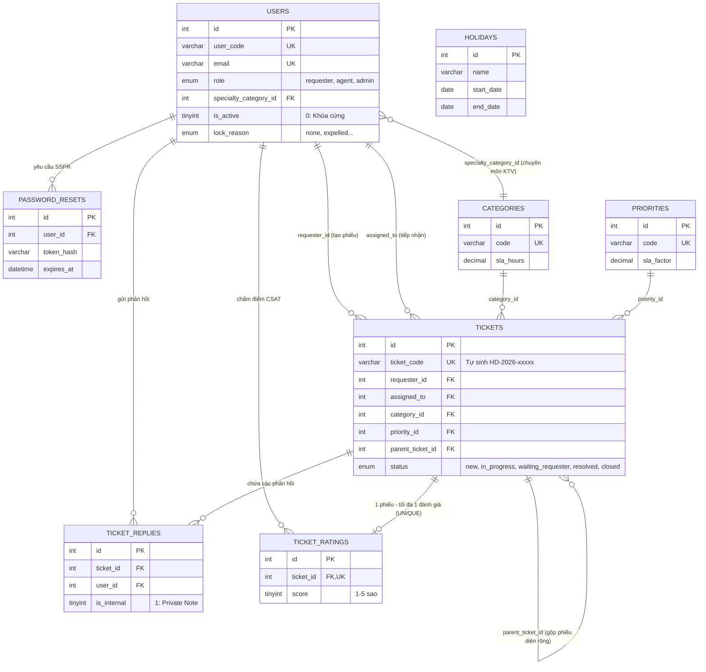

# TRƯỜNG ĐẠI HỌC THỦ ĐÔ HÀ NỘI
### KHOA CÔNG NGHỆ THÔNG TIN · BÀI TẬP LỚN LẬP TRÌNH WEB (HỌC KỲ I)
---
# 🎓 CHỦ ĐỀ 9: HỆ THỐNG TIẾP NHẬN & XỬ LÝ HỖ TRỢ CNTT TRỰC TUYẾN (HELPDESK ONLINE)
> **Phiên bản:** Chuẩn Đại học Thủ Đô Hà Nội · ITIL v4 Service Desk · Pure Online Services · PHP 8 Clean MVC  
> **Hệ thống Portal:** `https://it-support.daihocthudo.edu.vn`  
> **Tài liệu đặc tả kiến trúc chi tiết (PDF):** [Tai_Lieu_Dac_Ta_Helpdesk_DaiHocThuDo_Ban_Moi_Nhat.pdf](Thanhngan/Tai_Lieu_Dac_Ta_Helpdesk_DaiHocThuDo_Ban_Moi_Nhat.pdf)

---

## 👥 1. DANH SÁCH THÀNH VIÊN NHÓM 1

| STT | Họ và Tên | Mã Sinh Viên | Vai trò trong Nhóm | Email Sinh Viên Trường |
|:---:|---|:---:|:---:|---|
| 1 | **Phạm Thị Thanh Ngân** | **224001736** | **Trưởng nhóm** | `224001736@daihocthudo.edu.vn` |
| 2 | **Trần Thục Linh** | **224001729** | Thành viên | `224001729@daihocthudo.edu.vn` |
| 3 | **Lê Hà My** | **224001735** | Thành viên | `224001735@daihocthudo.edu.vn` |
| 4 | **Nguyễn Ánh Nhi** | **224001742** | Thành viên | `224001742@daihocthudo.edu.vn` |
| 5 | **Phan Công Thành** | **224001746** | Thành viên | `224001746@daihocthudo.edu.vn` |

---

## 🛠️ 2. CÁC NGUỒN CÔNG NGHỆ & TÀI LIỆU THAM KHẢO (TECH STACK & SOURCES)

### A. Nền tảng Công nghệ Sử dụng (Technology Stack)
* **Backend:** **PHP 8.1+ thuần**, kiến trúc **Clean MVC phân tầng triệt để**, tuân thủ chuẩn mã nguồn **PSR-4** (Autoloading) và **PSR-12** (Coding Style).
* **Cơ sở dữ liệu:** **MySQL 8.0+ InnoDB utf8mb4**:
  * Sử dụng **PDO Prepared Statements** chống 100% tấn công SQL Injection.
  * Quản trị giao dịch toàn vẹn **ACID Transactions (`beginTransaction`, `commit`, `rollBack`)** với cơ chế khóa dòng `FOR UPDATE` chống tranh chấp dữ liệu (Race Condition) khi phân công KTV.
  * Cột mã phiếu tự sinh tự động bằng **MySQL 8 Computed Column**: `CONCAT('HD-', YEAR(created_at), '-', LPAD(id, 5, '0')) STORED UNIQUE`.
* **Frontend:** **HTML5 / CSS3 Responsive (Mobile-First)**, giao diện thuần tối ưu tốc độ tải trang, không phụ thuộc thư viện nặng.
* **JavaScript & Giao tiếp API:** **Vanilla JavaScript Fetch API**, render an toàn bằng thuộc tính `.textContent` nhằm triệt tiêu lỗ hổng **Stored / Reflected Cross-Site Scripting (XSS)**.
* **Bảo mật Đa tầng:**
  * Mã hóa mật khẩu một chiều bằng thuật toán **Bcrypt / Argon2id** (`password_hash`).
  * Phòng chống tấn công **Brute-force:** Khóa mềm (Soft Lock) 30 phút khi nhập sai quá 5 lần; khóa cứng (Hard Lock) tài khoản kỷ luật buộc thôi học.
  * Kiểm duyệt tệp tải lên 5 lớp (MIME whitelist, Extension whitelist, kiểm tra GetImageSize, giới hạn 2MB, **lưu trữ tệp ngoài Webroot** tại `storage/uploads/`).
  * Tấm lọc mã độc **Formula Injection** khi xuất báo cáo dữ liệu CSV.

### B. Các Nguồn Thư viện & Giao thức Tích hợp
1. **PHPMailer / Gmail SMTP Server:** Tích hợp dịch vụ ngầm gửi email tự động 24/7 phục vụ cơ chế Tự phục vụ Đổi/Quên mật khẩu (SSPR) trong 15 phút.
2. **Canvas LMS REST API & LTI 1.3:** Tích hợp đồng bộ dữ liệu học phần, sinh viên lớp học phần và script tự động hiệu chỉnh lịch nghỉ lễ trường học.
3. **Microsoft Graph API / M365 Admin SDK:** Tích hợp quản lý bản quyền phần mềm Microsoft 365 Education và quản trị hòm thư `@daihocthudo.edu.vn`.
4. **RADIUS Protocol (802.1X PEAP/MSCHAPv2):** Chuẩn xác thực tài khoản mạng không dây sinh viên `THUDO-UNI` và `THUDO-STUDENT`.
5. **OpenVPN / WireGuard Protocol:** Cung cấp tệp cấu hình truy cập cơ sở dữ liệu Thư viện số Đại học Thủ Đô Hà Nội từ xa.

### C. Nguồn Chuẩn Nghiệp vụ & Khung Tham Chiếu
* **ITIL v4 (Information Technology Infrastructure Library v4):** Kế thừa tiêu chuẩn Quản trị Dịch vụ CNTT doanh nghiệp gồm:
  * **Auto-Priority Mapping:** Chống bão phiếu bằng cách loại bỏ quyền chọn Priority của người dùng.
  * **Skill-based Routing & Overflow Load Balancing:** Định luồng theo kỹ năng chuyên môn kết hợp cân bằng tải tràn tự động.
  * **Major Incident Management & Ticket Deflection:** Gộp phiếu sự cố diện rộng (Parent-Child Ticket) và treo biểu ngữ khẩn cấp ngăn bão phiếu tràn tải.

---

## 📋 3. MA TRẬN PHÂN CÔNG NHIỆM VỤ CHI TIẾT (RACI MATRIX)

| Thành viên thực hiện | Phân hệ phụ trách | Hạng mục công việc & Sản phẩm bàn giao cụ thể |
|---|---|---|
| **Phạm Thị Thanh Ngân**<br>*(Trưởng nhóm)* | **Core Architecture & Agent Module** | • Thiết kế toàn diện Database Schema, Migration & Seeders chuẩn Đại học Thủ Đô.<br>• Xây dựng nhân MVC Core: Router, Front Controller, PDO Wrapper, Exception Handler.<br>• Triển khai `TicketService`: Thuật toán phân công 5 KTV chuyên môn & cơ chế Tràn tải tự động nguyên tử.<br>• Xây dựng **Module Kỹ thuật viên (Agent Workspace)**: Hàng đợi theo SLA `due_at ASC`, Bàn làm việc KTV, ghi chú nội bộ bảo mật (`is_internal = 1`), biên bản giải pháp `resolved`.<br>*(Sản phẩm: Nhân MVC, CSDL MySQL 8 và Phân hệ KTV hoàn chỉnh)* |
| **Trần Thục Linh** | **User Management & SSPR Security** | • Xây dựng hệ thống xác thực Auth: Login, Logout, bắt buộc đổi mật khẩu lần đầu (`is_first_login = 1`).<br>• Triển khai **Cổng Tự phục vụ Mật khẩu (SSPR)** qua Email với Token SHA-256 hiệu lực 15 phút.<br>• Triển khai **Khóa cứng tài khoản buộc thôi học** (`lock_reason = 'expelled'`): Chặn đăng nhập, hủy token, chặn SSPR và cảnh báo KTV từ chối mở khóa.<br>• Triển khai **Form Báo sự cố Công khai (Guest Ticket)** dành cho tài khoản bị khóa cứng.<br>• Xây dựng `CsrfMiddleware`, chống Brute-force và Module Quản trị tài khoản Admin.<br>*(Sản phẩm: Hệ thống Auth, SSPR qua Mail, Guest Ticket Form, Quản trị người dùng Admin)* |
| **Lê Hà My** | **Lecturer Module & Auto-SLA Engine** | • Xây dựng **Module Giảng viên (Lecturer Portal)**: Hỗ trợ Fast-track ưu tiên cao, cho phép chọn `HIGH`/`URGENT` cho giờ lên lớp, thi cử, nhập điểm.<br>• Phát triển `SlaService`: Tự động gán Auto-Priority từ Category, tính hạn chót theo giờ hành chính (loại trừ ban đêm, Thứ 7/CN).<br>• Xây dựng cơ chế đóng băng đồng hồ SLA khi ở trạng thái `waiting_requester`.<br>• Lập trình các script CLI độc lập: `cli/auto_close.php` (tự đóng phiếu sau 72h) và `cli/sync_lms_holidays.php` (quét và dời lịch học trùng ngày lễ trên LMS).<br>*(Sản phẩm: Phân hệ Giảng viên, Động cơ Auto-SLA và Bộ tác vụ CLI tự động)* |
| **Nguyễn Ánh Nhi** | **Student Module & RESTful API** | • Xây dựng **Module Sinh viên (Student Portal)**: Form báo lỗi tinh gọn (bỏ ô chọn Priority), Workspace theo dõi tiến độ, trao đổi trực tuyến, nghiệm thu và chấm sao CSAT.<br>• Xây dựng **Biểu ngữ Thông báo Khẩn (Major Incident Alert Banner)** trên giao diện để ngăn sinh viên tạo phiếu trùng khi có sự cố diện rộng.<br>• Xây dựng `UploadService` kiểm duyệt an toàn 5 lớp cho ảnh chụp màn hình lỗi và ảnh thẻ SV ngoài webroot.<br>• Phát triển các RESTful JSON API Endpoints phục vụ Fetch API cập nhật huy hiệu và lịch sử bất đồng bộ.<br>*(Sản phẩm: Phân hệ Sinh viên, Module Upload an toàn và Hệ thống RESTful API)* |
| **Phan Công Thành** | **Admin Dashboard & UI Analytics** | • Thiết kế toàn bộ giao diện HTML5/CSS3 chuẩn Mobile-first, hiện đại, thân thiện, bao gồm giao diện Tra cứu Guest Ticket bằng mã PIN.<br>• Xây dựng **Bảng điều khiển Quản trị (Admin Dashboard Control Center)**: Giám sát cờ tải hệ thống thời gian thực (Xanh / Vàng / Đỏ), kích hoạt gộp phiếu sự cố chủ (Parent-Child Ticket).<br>• Lập trình JavaScript Fetch API cập nhật dữ liệu tự động không cần reload trang.<br>• Xây dựng Module xuất báo cáo thống kê sự cố ra file CSV có gắn cờ chống Formula Injection.<br>*(Sản phẩm: Toàn bộ giao diện người dùng hoàn thiện và Bảng điều khiển phân tích Admin)* |

---

## 🚦 4. BẢNG PHÂN LOẠI 5 NHÓM DỊCH VỤ & 5 KTV CHUYÊN TRÁCH

| Nhóm Dịch Vụ Online | Mã Nhóm | Sự cố & Yêu cầu xử lý từ xa | Auto-SLA | KTV Chuyên Trách |
|---|:---:|---|:---:|:---:|
| **1. Tài khoản & Xác thực SSO** | `CAT_SSO` | Cấp lại mật khẩu, mở khóa tài khoản, xử lý Guest Ticket mở khóa cứng, lỗi đồng bộ danh tính. | **2.0 giờ** | **KTV 1** (Chuyên môn SSO & Auth) |
| **2. Email & Microsoft 365** | `CAT_MAIL` | Kích hoạt bản quyền Office 365 Edu, khôi phục hòm thư bị khóa spam, mở rộng quota OneDrive 1TB. | **4.0 giờ** | **KTV 2** (Chuyên môn Email & Cloud) |
| **3. Cổng Quản lý Đào tạo** | `CAT_QLDT` | Nghẽn phiên đăng ký tín chỉ (gộp Parent Ticket), tra cứu điểm thi, cấp quyền nhập điểm GV (khẩn cấp 0.5h). | **2.0 giờ** | **KTV 3** (Chuyên môn Hệ thống QLĐT) |
| **4. LMS Canvas & MS Teams** | `CAT_CANVAS` | Lỗi không thấy lớp học, lỗi nộp bài tập lớn, tạo phòng học Teams, **sửa lịch học trùng ngày lễ toàn trường**. | **2.0 giờ** | **KTV 4** (Chuyên môn E-Learning) |
| **5. Wi-Fi Trường & VPN Từ xa** | `CAT_WIFI` | Lỗi xác thực mạng `THUDO-UNI`, tràn địa chỉ IP (DHCP) Ký túc xá, cấp file `.ovpn` truy cập Thư viện số từ xa. | **4.0 giờ** | **KTV 5** (Chuyên môn Mạng & Hạ tầng) |

---

## 🛣️ 5. DANH SÁCH 20 ROUTE THỐNG NHẤT TOÀN HỆ THỐNG

| STT | Phương thức | Đường dẫn (URL) | Controller & Action | Vai trò được phép | Mục đích nghiệp vụ |
|:---:|:---:|---|---|:---:|---|
| 1 | `GET` | `/login` | `AuthController@showLogin` | Khách | Giao diện đăng nhập hệ thống |
| 2 | `POST` | `/login` | `AuthController@login` | Khách | Xác thực thông tin đăng nhập |
| 3 | `POST` | `/logout` | `AuthController@logout` | Đã đăng nhập | Hủy session, đăng xuất an toàn |
| 4 | `GET` | `/forgot-password` | `AuthController@showForgotPassword` | Khách | Giao diện yêu cầu khôi phục mật khẩu (SSPR) |
| 5 | `POST` | `/forgot-password` | `AuthController@sendResetLink` | Khách | Sinh token 15p và gửi mail khôi phục |
| 6 | `GET/POST`| `/reset-password` | `AuthController@resetPassword` | Khách | Xác thực token và đặt lại mật khẩu mới |
| 7 | `GET/POST`| `/guest-ticket` | `GuestTicketController@create` | Khách | Gửi yêu cầu mở khóa tài khoản bị khóa cứng |
| 8 | `GET` | `/tra-cuu` | `GuestTicketController@track` | Khách | Tra cứu tiến độ Guest Ticket bằng Mã vé + PIN |
| 9 | `GET` | `/tickets/create` | `TicketController@create` | Sinh viên, Giảng viên | Giao diện gửi phiếu báo sự cố |
| 10 | `POST` | `/tickets/create` | `TicketController@store` | Sinh viên, Giảng viên | Tiếp nhận phiếu (Auto-Priority Mapping) |
| 11 | `GET` | `/tickets/my` | `TicketController@myTickets` | Sinh viên, Giảng viên | Dashboard cá nhân theo dõi phiếu |
| 12 | `GET` | `/tickets/show?code=...` | `TicketController@show` | Chủ phiếu, KTV, Admin | Xem chi tiết phiếu và tiến độ xử lý |
| 13 | `POST` | `/tickets/reply` | `TicketController@reply` | Chủ phiếu, KTV, Admin | Trao đổi hai chiều hoặc ghi chú nội bộ |
| 14 | `GET` | `/tickets/attachment?code=...`| `AttachmentController@download` | Người có quyền | Phục vụ xem ảnh chụp lỗi ngoài webroot |
| 15 | `POST` | `/tickets/rate` | `TicketController@rate` | Chủ phiếu | Chấm điểm hài lòng CSAT 1-5 sao |
| 16 | `GET` | `/agent/queue` | `AgentController@queue` | KTV, Admin | Hàng đợi xử lý phiếu theo `due_at ASC` |
| 17 | `POST` | `/tickets/status` | `AgentController@updateStatus` | KTV được giao, Admin | Chuyển trạng thái (`waiting_requester`, `resolved`) |
| 18 | `GET` | `/admin/dashboard` | `AdminController@dashboard` | Admin | Dashboard giám sát tải Xanh/Vàng/Đỏ |
| 19 | `POST` | `/admin/tickets/major-incident` | `AdminController@createMajorIncident` | Admin | Kích hoạt sự cố diện rộng, gộp phiếu chủ |
| 20 | `GET` | `/admin/reports/export-csv` | `AdminController@exportCsv` | Admin | Xuất báo cáo CSV chống Formula Injection |

---

## 📂 6. CẤU TRÚC MÃ NGUỒN CLEAN MVC (PSR-4)

```text
bai-tap-lon-lap-trinh-web-nhom1/
├── app/
│   ├── Controllers/             # Nhận Request, validate đầu vào (422), gọi Service
│   │   ├── AuthController.php   # Login, Logout, Đổi mật khẩu lần đầu, Quên pass SSPR
│   │   ├── GuestTicketController.php # Xử lý báo khóa tài khoản công khai & tra cứu bằng PIN
│   │   ├── Student/             # Phân hệ dành riêng cho Sinh viên
│   │   │   ├── StudentDashboardController.php
│   │   │   └── StudentTicketController.php   # Báo lỗi tinh gọn, chặn tạo phiếu khi có Major Incident
│   │   ├── Lecturer/            # Phân hệ dành riêng cho Giảng viên (ưu tiên HIGH/URGENT)
│   │   │   ├── LecturerDashboardController.php
│   │   │   └── LecturerTicketController.php  # Hỗ trợ đào tạo, nghiên cứu
│   │   ├── Agent/               # Phân hệ dành riêng cho Kỹ thuật viên (KTV)
│   │   │   ├── AgentQueueController.php      # Hàng đợi phiếu cá nhân + Tràn tải
│   │   │   └── AgentWorkbenchController.php  # Xử lý sự cố, mở khóa TK, đóng phiếu diện rộng
│   │   ├── Admin/               # Phân hệ Quản trị viên Trung tâm CNTT
│   │   │   ├── AdminTicketController.php     # Kích hoạt Major Incident Banner, gộp phiếu chủ
│   │   │   └── AdminUserController.php       # Khóa cứng tài khoản buộc thôi học (expelled)
│   │   └── Api/                 # JSON API phục vụ Fetch API cập nhật tự động
│   ├── Services/                # LÕI NGHIỆP VỤ & QUẢN TRỊ GIAO DỊCH DATABASE (100% PHP PDO)
│   │   ├── AuthService.php      # Xác thực, SSPR qua Email, chặn TK buộc thôi học
│   │   ├── TicketService.php    # State Machine 5 bước, Phân công Chuyên môn & Tràn tải
│   │   ├── SlaService.php       # Động cơ tính toán hạn chót theo giờ hành chính
│   │   └── UploadService.php    # 5 lớp kiểm soát an toàn tệp ảnh tải lên ngoài webroot
│   ├── Policies/                # KIỂM SOÁT PHÂN QUYỀN TRÊN TỪNG PHIẾU
│   │   └── TicketPolicy.php     # canView, canReply, canTransition, canRate
│   ├── Models/                  # TRUY VẤN DỮ LIỆU QUA PDO PREPARED STATEMENTS
│   │   ├── User.php, Ticket.php, Reply.php, PasswordReset.php, Holiday.php, MasterData.php
│   └── Middlewares/             # TẤM LỌC ĐẦU VÀO
│       ├── AuthMiddleware.php   # Bắt buộc đăng nhập (bỏ qua với Guest Ticket và SSPR)
│       ├── RoleMiddleware.php   # Phân quyền: student, lecturer, agent, admin
│       └── CsrfMiddleware.php   # Xác thực token chống tấn công CSRF (POST/PUT/DELETE)
├── config/                      # CẤU HÌNH HỆ THỐNG
│   ├── database.php             # Kết nối PDO utf8mb4, ERRMODE_EXCEPTION, fetch assoc
│   └── app.php                  # Thiết lập múi giờ '+07:00', thông số tải, mail SMTP
├── database/                    # MIGRATION VÀ DỮ LIỆU SEEDERS
│   ├── schema.sql               # Toàn bộ cấu trúc bảng và chỉ mục tối ưu
│   └── seeders.sql              # Tài khoản mẫu ĐH Thủ Đô, 5 danh mục dịch vụ, lịch nghỉ lễ
├── public/                      # THƯ MỤC CÔNG KHAI DUY NHẤT (WEBROOT)
│   ├── index.php                # Front Controller duy nhất đón nhận 100% request
│   ├── .htaccess                # Điều hướng toàn bộ request vào index.php
│   └── assets/                  # style.css responsive Mobile-first, app.js Fetch API
├── storage/                     # LƯU TRỮ TỆP NỘI BỘ (NẰM BÊN NGOÀI WEBROOT)
│   ├── uploads/                 # Ảnh chụp màn hình lỗi và ảnh thẻ SV
│   └── logs/                    # app-YYYY-MM-DD.log ghi lỗi hệ thống
├── views/                       # GIAO DIỆN HTML (Escape an toàn qua htmlspecialchars)
│   ├── layouts/                 # Header, Footer, Sidebar theo vai trò
│   ├── auth/                    # Giao diện Đăng nhập, Quên mật khẩu SSPR
│   ├── guest/                   # Giao diện Báo tài khoản bị khóa & Tra cứu bằng PIN
│   ├── student/                 # Giao diện Sinh viên
│   ├── lecturer/                # Giao diện Giảng viên
│   ├── agent/                   # Bàn làm việc KTV
│   └── admin/                   # Bảng điều khiển Quản trị Admin
├── cli/                         # TÁC VỤ CHẠY NGẦM ĐỘC LẬP
│   ├── auto_close.php           # Script tự động đóng phiếu sau 72h
│   └── sync_lms_holidays.php    # Script CLI tự động quét và dời lịch học trùng ngày lễ trên LMS
└── README.md                    # Tài liệu giới thiệu, phân công và hướng dẫn vận hành
```

---

## 🗄️ 7. THIẾT KẾ CƠ SỞ DỮ LIỆU (CSDL) & SƠ ĐỒ ERD

> Chi tiết đặc tả từng cột và hệ màu giao diện xem tại: 👉 [**CSDL_VA_ERD_NHOM1.md**](CSDL_VA_ERD_NHOM1.md)

### A. Sơ đồ Thực thể Liên kết (ERD)
Hệ thống chuẩn hóa 8 bảng dữ liệu tối thiểu, đảm bảo chuẩn hóa 3NF, ràng buộc toàn vẹn khóa ngoại và khóa duy nhất:



### B. Danh sách 8 Bảng Dữ liệu Tối thiểu
1. **`users`:** Quản lý tài khoản (Sinh viên, Giảng viên, 5 KTV, Admin). Chứa cơ chế Khóa mềm (`locked_until`), Khóa cứng buộc thôi học (`lock_reason = 'expelled'`), và cờ chuyên môn KTV (`specialty_category_id`).
2. **`categories`:** 5 nhóm dịch vụ trực tuyến (`CAT_SSO`, `CAT_MAIL`, `CAT_QLDT`, `CAT_CANVAS`, `CAT_WIFI`) kèm hạn SLA chuẩn.
3. **`priorities`:** 4 mức ưu tiên (`URGENT`, `HIGH`, `MED`, `LOW`) kèm hệ số rút ngắn SLA `sla_factor`.
4. **`tickets`:** Bảng trung tâm lưu trữ phiếu hỗ trợ. Mã vé `ticket_code` sinh tự động bởi MySQL 8 (`STORED UNIQUE`), hỗ trợ cờ `is_guest_ticket`, mã PIN tra cứu `lookup_pin`, và gộp phiếu diện rộng `parent_ticket_id`.
5. **`ticket_replies`:** Lưu trao đổi hai chiều giữa người dùng và KTV, có cờ `is_internal = 1` ghi chú nội bộ.
6. **`ticket_ratings`:** Lưu đánh giá độ hài lòng CSAT 1–5 sao của sinh viên (ràng buộc `UNIQUE (ticket_id)` quan hệ 1-1).
7. **`password_resets`:** Lưu token khôi phục mật khẩu tự động qua email (SSPR) hiệu lực 15 phút.
8. **`holidays`:** Lưu lịch nghỉ lễ toàn trường phục vụ thuật toán trừ giờ hành chính và dời lịch LMS tự động.

---

## ⚡ 8. HƯỚNG DẪN CHẠY SCRIPT TẠO CƠ SỞ DỮ LIỆU (DATABASE RUN GUIDE)

Hệ thống cung cấp sẵn 2 tập tin SQL tại thư mục `database/`:
* 📄 [`database/schema.sql`](database/schema.sql): Tập tin DDL tạo cấu trúc CSDL và 8 bảng hoàn chỉnh.
* 📄 [`database/seed.sql`](database/seed.sql): Tập tin DML nạp dữ liệu mẫu sẵn sàng đăng nhập trải nghiệm.

### Cách 1: Chạy qua phpMyAdmin (Giao diện XAMPP)
1. Mở trình duyệt, vào `http://localhost/phpmyadmin`.
2. Tạo CSDL mới tên: **`helpdesk_thudo`** (Collation: `utf8mb4_unicode_ci`).
3. Bấm vào tab **Import** (Nhập):
   * Lần 1: Chọn file `database/schema.sql` &rarr; Bấm **Import** để tạo bảng.
   * Lần 2: Chọn file `database/seed.sql` &rarr; Bấm **Import** để nạp tài khoản và dữ liệu mẫu.

### Cách 2: Chạy qua Dòng lệnh MySQL (Command Line / Terminal)
```bash
# 1. Chạy DDL tạo cấu trúc bảng
mysql -u root -p helpdesk_thudo < database/schema.sql

# 2. Chạy DML nạp dữ liệu mẫu
mysql -u root -p helpdesk_thudo < database/seed.sql
```

### Kiểm tra sau khi nạp:
* Tài khoản mẫu mặc định đều có mật khẩu: **`Thudo@2026!`**
  * **Admin:** `admin@daihocthudo.edu.vn`
  * **KTV 1 (Chuyên trách SSO):** `ktv1@daihocthudo.edu.vn`
  * **Giảng viên:** `gv.cntt@daihocthudo.edu.vn`
  * **Sinh viên:** `224001736@daihocthudo.edu.vn`

---

## 🎨 9. HỆ MÃ MÀU ĐỒNG BỘ GIAO DIỆN (UI COLOR TOKENS)

Toàn bộ hệ thống giao diện Web (CSS) được chuẩn hóa theo hệ màu **"Thudo Metropolitan Blue & Modern Slate"**:
* **Màu chủ đạo (Primary):** `#0284c7` (Sky Blue 600) | Hover: `#0369a1` | Nhạt: `#e0f2fe`
* **Màu nền tối (Navbar/Sidebar):** `#0f172a` (Slate 900)
* **Màu nền trang (Body):** `#f8fafc` (Slate 50) | Nền thẻ Card: `#ffffff` | Viền: `#cbd5e1`
* **Màu trạng thái (Status Badges):**
  * `new`: Chữ `#0284c7` / Nền `#e0f2fe`
  * `in_progress`: Chữ `#b45309` / Nền `#fef3c7`
  * `waiting_requester`: Chữ `#7c3aed` / Nền `#f5f3ff`
  * `resolved`: Chữ `#15803d` / Nền `#dcfce7`
  * `closed`: Chữ `#475569` / Nền `#f1f5f9`
  * `urgent / alert`: Chữ `#b91c1c` / Nền `#fee2e2`
   * **Giảng viên (Lecturer):** Tài khoản `gv.cntt@daihocthudo.edu.vn` | Mật khẩu: `Thudo@2026!`
   * **Sinh viên (Student):** Tài khoản `224001736@daihocthudo.edu.vn` | Mật khẩu: `Thudo@2026!`

---

🏆 **KẾT LUẬN & CAM KẾT CHẤT LƯỢNG:**  
Hệ thống Helpdesk CNTT Nhóm 1 được xây dựng chuẩn mực theo mô hình kiến trúc công nghệ hiện đại, vừa vặn, đáp ứng toàn diện các tiêu chí khắt khe của môn học và các tình huống vận hành thực tế tại Trường Đại học Thủ Đô Hà Nội. Đồ án cam kết mang lại sản phẩm hoàn chỉnh và điểm số xuất sắc (Grade A+) cho cả nhóm!
