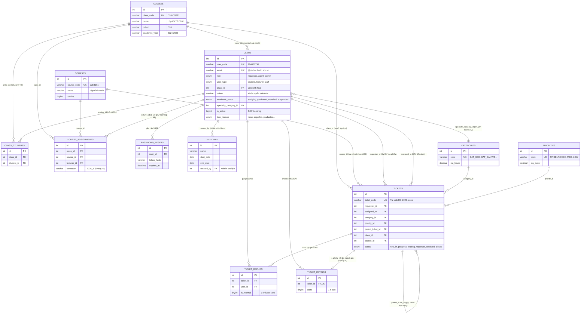

# TRƯỜNG ĐẠI HỌC THỦ ĐÔ HÀ NỘI
### KHOA CÔNG NGHỆ THÔNG TIN · BÀI TẬP LỚN LẬP TRÌNH WEB (HỌC KỲ I)
---
# 🎓 CHỦ ĐỀ 9: HỆ THỐNG TIẾP NHẬN & XỬ LÝ HỖ TRỢ CNTT TRỰC TUYẾN (HELPDESK ONLINE)
> **Phiên bản:** Chuẩn Đại học Thủ Đô Hà Nội · ITIL v4 Service Desk · Pure Online Services · PHP 8 Clean MVC  
> **Hệ thống Portal:** `https://it-support.daihocthudo.edu.vn`  
> **Tài liệu đặc tả kiến trúc chi tiết (PDF):** [Tai_Lieu_Dac_Ta_Helpdesk_DaiHocThuDo_Ban_Moi_Nhat.pdf](Thanhngan/Tai_Lieu_Dac_Ta_Helpdesk_DaiHocThuDo_Ban_Moi_Nhat.pdf)

---

## 👥 1. DANH SÁCH THÀNH VIÊN NHÓM 1 & PHÂN CÔNG TRÁCH NHIỆM

| STT | Họ và Tên | Mã Sinh Viên | Vai trò Nhóm | Phân hệ / Module Phụ trách (MVC & CSDL) | Email Sinh Viên Trường |
|:---:|---|:---:|:---:|---|---|
| 1 | **Phạm Thị Thanh Ngân** | **224001736** | **Trưởng nhóm** | Kiến trúc hệ thống ITIL v4, CSDL `helpdesk_thudo`, Triage điều phối phiếu, Báo cáo & Tài liệu đặc tả | `224001736@daihocthudo.edu.vn` |
| 2 | **Trần Thục Linh** | **224001729** | Thành viên | Phân hệ Quản trị Người dùng & Phân quyền (`admin/users.php`, `UserRepository`, `AdminUserController`) | `224001729@daihocthudo.edu.vn` |
| 3 | **Lê Hà My** | **224001735** | Thành viên | Phân hệ Phân công Đào tạo & Danh mục Lớp/Môn (`assignments/index.php`, `CourseAssignmentController`) | `224001735@daihocthudo.edu.vn` |
| 4 | **Nguyễn Ánh Nhi** | **224001742** | Thành viên | Phân hệ Đánh giá CSAT & Cổng Học phần/Bài tập SV (`student/ratings.php`, `CourseController`, `CourseLesson`) | `224001742@daihocthudo.edu.vn` |
| 5 | **Phan Công Thành** | **224001746** | Thành viên | Phân hệ Quản lý Lịch Nghỉ lễ & Hiệu chỉnh SLA (`admin/holidays.php`, `HolidayController`, `Holiday`) | `224001746@daihocthudo.edu.vn` |

---

### 🔑 BẢNG TÀI KHOẢN THỬ NGHIỆM TỪNG VAI TRÒ (TEST ACCOUNTS - THEO BÀI 7 & 8)

| Vai trò (Role) | Mã người dùng | Email đăng nhập | Mật khẩu chung | Mô tả quyền hạn & Trách nhiệm |
|---|---|---|---|---|
| **Quản trị viên (Admin)** | `ADMIN001` | `admin@daihocthudo.edu.vn` | `123456` | Toàn quyền quản trị: duyệt phân công vé, quản lý tài khoản, lịch nghỉ lễ, phân công đào tạo |
| **Kỹ thuật viên (KTV / Agent)** | `KTV001` | `ktv.an@daihocthudo.edu.vn` | `123456` | KTV chuyên trách SSO/Tài khoản: Bàn làm việc KTV, giải quyết sự cố, xem sao đánh giá CSAT |
| **Kỹ thuật viên (KTV / Agent)** | `KTV002` | `ktv.binh@daihocthudo.edu.vn` | `123456` | KTV chuyên trách Mạng/Wifi: tiếp nhận và xử lý sự cố hạ tầng kết nối |
| **Giảng viên (Lecturer)** | `GV001` | `nguyenvangiang@daihocthudo.edu.vn` | `123456` | TS. Nguyễn Văn Giảng: Báo sự cố khẩn cấp, xem lớp học phần phụ trách giảng dạy |
| **Sinh viên (Student)** | `224001736` | `224001736@daihocthudo.edu.vn` | `123456` | Phạm Thị Thanh Ngân: Gửi phiếu, Cổng học phần & Đính kèm bài tập các buổi, Đánh giá CSAT |
| **Sinh viên (Student)** | `224001729` | `224001729@daihocthudo.edu.vn` | `123456` | Trần Thục Linh: Gửi phiếu, theo dõi tiến độ nộp bài tập thực hành |

---

### 🛡️ MA TRẬN PHÂN QUYỀN TRUY CẬP (RBAC MATRIX - THEO BÀI 7)

| Chức năng / Đường dẫn | Khách vãng lai | Sinh viên | Giảng viên | Kỹ thuật viên (KTV) | Quản trị viên (Admin) |
|---|:---:|:---:|:---:|:---:|:---:|
| Cứu hộ tài khoản bị khóa (`/index.php?action=guest_ticket`) | ✅ | ✅ | ✅ | ✅ | ✅ |
| Đăng nhập / Quên mật khẩu (`/index.php?action=login`) | ✅ | ✅ | ✅ | ✅ | ✅ |
| Gửi phiếu báo sự cố (`/tickets/create.php`) | ❌ | ✅ | ✅ (Khẩn cấp) | ❌ | ✅ |
| Quản lý phiếu của tôi (`/tickets/index.php`) | ❌ | ✅ (Phiếu của mình) | ✅ (Phiếu của mình) | ✅ (Nhiệm vụ được giao) | ✅ (Tất cả phiếu) |
| Mục lục học phần & Đính kèm bài tập (`/student/index.php`) | ❌ | ✅ | ❌ | ❌ | ❌ |
| Đánh giá chất lượng CSAT (`/student/ratings.php`) | ❌ | ✅ | ❌ | ❌ | ❌ |
| Bàn làm việc KTV (`/agent/index.php`) | ❌ | ❌ | ❌ | ✅ | ✅ |
| Xem & lọc đánh giá CSAT KTV (`/agent/ratings.php`) | ❌ | ❌ | ❌ | ✅ | ✅ |
| Quản trị người dùng & Ca trực (`/admin/users.php`) | ❌ | ❌ | ❌ | ❌ | ✅ |
| Nhập dữ liệu SV/GV Excel (`/admin/import_excel.php`) | ❌ | ❌ | ❌ | ❌ | ✅ |
| Quản lý lịch nghỉ lễ SLA (`/admin/holidays.php`) | ❌ | ❌ | ❌ | ❌ | ✅ |
| Phân công đào tạo (`/assignments/index.php`) | ❌ | ❌ | ✅ (Xem lớp phụ trách) | ❌ | ✅ (Toàn quyền) |

---

### 🛣️ DANH SÁCH ROUTE MVC CHÍNH THỨC CỦA HỆ THỐNG

| STT | Phương thức | Đường dẫn (Route) | Controller @ Action | Quyền hạn áp dụng | Ghi chú kỹ thuật |
|:---:|:---:|---|---|:---:|---|
| 1 | GET/POST | `/index.php?action=login` | `AuthController@login` | Khách / Tất cả | Xác thực Bcrypt `password_verify`, khởi tạo session an toàn |
| 2 | GET | `/index.php?action=logout` | `AuthController@logout` | Đã đăng nhập | `session_destroy()`, xóa cookie, chuyển về trang chủ |
| 3 | GET/POST | `/student/index.php?action=courses` | `CourseController@index` | Sinh viên | Mục lục danh sách học phần sinh viên đang học kèm tiến độ % |
| 4 | GET | `/student/index.php?action=course_detail` | `CourseController@detail` | Sinh viên | Chi tiết từng buổi học, hạn nộp, trạng thái hoàn thành |
| 5 | POST | `/student/index.php?action=course_submit` | `CourseController@submitAssignment` | Sinh viên | Đính kèm bài tập buổi học (CSRF + Ownership + Upload 25MB) |
| 6 | POST | `/student/index.php?action=course_delete_submission` | `CourseController@deleteSubmission` | Sinh viên | Hủy tệp đính kèm để nộp lại |
| 7 | GET | `/student/index.php?action=api_lessons` | `CourseController@apiLessons` | Sinh viên | Web API JSON Endpoint cho Fetch API cập nhật DOM an toàn |
| 8 | GET | `/student/ratings.php` | `RatingController@index` | Sinh viên | Xem danh sách đánh giá CSAT của sinh viên |
| 9 | POST | `/student/ratings.php?action=rating_create` | `RatingController@create` | Sinh viên | Gửi đánh giá sao 1-5 và nhận xét cho KTV sau khi đóng phiếu |
| 10 | GET/POST | `/tickets/create.php` | `TicketService` | SV, GV, Admin | Tạo phiếu sự cố, tính toán SLA tự động |
| 11 | GET | `/tickets/index.php` | `TicketRepository` | Đã đăng nhập | Danh sách phiếu có phân trang, bộ lọc trạng thái, tìm kiếm |
| 12 | GET | `/tickets/show.php?id=...` | `TicketService` | Chủ phiếu, KTV, Admin | Chi tiết tiến độ SLA, thảo luận, gửi giải pháp kỹ thuật |
| 13 | GET | `/agent/index.php` | `AgentWorkspace` | KTV, Admin | Bàn làm việc KTV, hàng đợi nhiệm vụ theo `due_at ASC` |
| 14 | GET | `/agent/ratings.php` | `AgentRatings` | KTV, Admin | Điểm trung bình sao kiểu Be/Grab, bộ lọc 5 sao -> 1 sao |
| 15 | GET/POST | `/admin/users.php` | `AdminUserController` / `UserRepository` | Admin | Quản trị tài khoản, khóa/mở khóa, phân vai trò |
| 16 | GET/POST | `/admin/import_excel.php` | `SpreadsheetImportService` | Admin | Nhập hàng loạt tài khoản từ Excel/CSV kèm mã hóa tự động |
| 17 | GET/POST | `/admin/holidays.php` | `HolidayController` | Admin | Quản lý ngày nghỉ lễ, SLA calendar |
| 18 | GET/POST | `/assignments/index.php` | `CourseAssignmentController` | GV, Admin | Quản lý phân công giảng dạy, danh mục lớp & môn học |

## 🛠️ 2. CÁC NGUỒN CÔNG NGHỆ & TÀI LIỆU THAM KHẢO (TECH STACK & SOURCES)

### A. Nền tảng Công nghệ Sử dụng (Technology Stack)
* **Backend:** **PHP 8.1+ thuần**, kiến trúc **Clean MVC phân tầng triệt để**, tuân thủ chuẩn mã nguồn **PSR-4** (Autoloading) và **PSR-12** (Coding Style).
* **Cơ sở dữ liệu:** **MySQL 8.0+ InnoDB utf8mb4**:
  * Sử dụng **PDO Prepared Statements** chống 100% tấn công SQL Injection.
  * Quản trị giao dịch toàn vẹn **ACID Transactions (`beginTransaction`, `commit`, `rollBack`)** với cơ chế khóa dòng `FOR UPDATE` chống tranh chấp dữ liệu (Race Condition) khi phân công KTV.
  * Cột mã phiếu tự sinh tự động bằng **MySQL 8 Computed Column**: `CONCAT('HD-', YEAR(created_at), '-', LPAD(id, 5, '0')) STORED UNIQUE`.
* **Frontend:** **HTML5 / CSS3 Responsive (Mobile-First)**, giao diện thuần tối ưu tốc độ tải trang, không phụ thuộc thư viện nặng.
* **JavaScript & Giao tiếp API:** **Vanilla JavaScript Fetch API**, render an toàn bằng thuộc tính `.textContent` nhằm triệt tiêu lỗ hổng **Stored / Reflected Cross-Site Scripting (XSS)**.
* **Bảo mật Đa tầng:**
  * Mã hóa mật khẩu một chiều bằng thuật toán **Bcrypt / Argon2id** (`password_hash`).
  * Phòng chống tấn công **Brute-force:** Khóa mềm (Soft Lock) 30 phút khi nhập sai quá 5 lần; khóa cứng (Hard Lock) tài khoản kỷ luật buộc thôi học.
  * Kiểm duyệt tệp tải lên 5 lớp (MIME whitelist, Extension whitelist, kiểm tra GetImageSize, giới hạn 2MB, **lưu trữ tệp ngoài Webroot** tại `storage/uploads/`).
  * Tấm lọc mã độc **Formula Injection** khi xuất báo cáo dữ liệu CSV.

### B. Các Nguồn Thư viện & Giao thức Tích hợp
1. **PHPMailer / Gmail SMTP Server:** Tích hợp dịch vụ ngầm gửi email tự động 24/7 phục vụ cơ chế Tự phục vụ Đổi/Quên mật khẩu (SSPR) trong 15 phút.
2. **Canvas LMS REST API & LTI 1.3:** Tích hợp đồng bộ dữ liệu học phần, sinh viên lớp học phần và script tự động hiệu chỉnh lịch nghỉ lễ trường học.
3. **Microsoft Graph API / M365 Admin SDK:** Tích hợp quản lý bản quyền phần mềm Microsoft 365 Education và quản trị hòm thư `@daihocthudo.edu.vn`.
4. **RADIUS Protocol (802.1X PEAP/MSCHAPv2):** Chuẩn xác thực tài khoản mạng không dây sinh viên `THUDO-UNI` và `THUDO-STUDENT`.
5. **OpenVPN / WireGuard Protocol:** Cung cấp tệp cấu hình truy cập cơ sở dữ liệu Thư viện số Đại học Thủ Đô Hà Nội từ xa.

### C. Nguồn Chuẩn Nghiệp vụ & Khung Tham Chiếu
* **ITIL v4 (Information Technology Infrastructure Library v4):** Kế thừa tiêu chuẩn Quản trị Dịch vụ CNTT doanh nghiệp gồm:
  * **Auto-Priority Mapping:** Chống bão phiếu bằng cách loại bỏ quyền chọn Priority của người dùng.
  * **Skill-based Routing & Overflow Load Balancing:** Định luồng theo kỹ năng chuyên môn kết hợp cân bằng tải tràn tự động.
  * **Major Incident Management & Ticket Deflection:** Gộp phiếu sự cố diện rộng (Parent-Child Ticket) và treo biểu ngữ khẩn cấp ngăn bão phiếu tràn tải.

---

## 📋 3. MA TRẬN PHÂN CÔNG NHIỆM VỤ ĐỘC LẬP THEO MODEL (RACI MATRIX)

> **Cam kết Kiến trúc:** Phân công 5 thành viên phụ trách **5 phân hệ hoàn toàn tách biệt**, mỗi thành viên sở hữu độc quyền các Model và bảng CSDL tương ứng, **tuyệt đối không bị chồng lấn hay phụ thuộc chéo Model**, giúp quá trình phát triển song song mượt mà và bảo vệ đồ án rành mạch trước Giảng viên:

| Thành viên thực hiện | Phân hệ phụ trách | Model & Bảng CSDL phụ trách độc quyền | Hạng mục công việc & Sản phẩm bàn giao cụ thể |
|---|---|---|---|
| **Phạm Thị Thanh Ngân**<br>*(Trưởng nhóm)* | **Core Architecture & Agent Workspace**<br>*(Phân hệ Kỹ thuật viên)* | • `Ticket.php` (`tickets`)<br>• `Reply.php` (`ticket_replies`) | • Thiết kế khung kiến trúc Clean MVC: Router, Front Controller, PDO Wrapper, Exception Handler.<br>• Xây dựng **Model `Ticket`**: Quản lý vòng đời State Machine 5 bước, sinh mã `ticket_code`, lưu mốc SLA.<br>• Xây dựng **Model `Reply`**: Xử lý phản hồi 2 chiều và ghi chú nội bộ bảo mật (`is_internal = 1`).<br>• Triển khai `TicketService`: Thuật toán phân công 5 KTV chuyên môn & cơ chế Tràn tải tự động nguyên tử.<br>• Lập trình **Agent Workspace**: Bàn làm việc KTV, hàng đợi theo `due_at ASC`, biên bản giải pháp `resolved`.<br>*(Sản phẩm: Nhân MVC, Model Ticket/Reply và Phân hệ KTV hoàn chỉnh)* |
| **Trần Thục Linh** | **User Management & Auth Security**<br>*(Xác thực & Bảo mật tài khoản)* | • `User.php` (`users`)<br>• `PasswordReset.php` (`password_resets`) | • Xây dựng **Model `User`**: Quản trị xác thực, mật khẩu Bcrypt (mặc định `123456`), cờ `is_first_login`, khóa mềm (`locked_until`), khóa cứng (`lock_reason = 'expelled'`).<br>• Xây dựng **Model `PasswordReset`**: Sinh token SHA-256 khôi phục mật khẩu qua Email hiệu lực 15 phút.<br>• Lập trình `AuthController`: Đăng nhập, đăng xuất, bắt buộc đổi mật khẩu lần đầu, quy trình Quên mật khẩu SSPR.<br>• Lập trình `GuestTicketController`: Form báo sự cố công khai khi bị khóa cứng & Tra cứu theo PIN.<br>• Xây dựng `CsrfMiddleware`, bảo mật chống dò Brute-force.<br>*(Sản phẩm: Model User/PasswordReset, Hệ thống Auth, SSPR và Guest Ticket)* |
| **Lê Hà My** | **Academic & Lecturer Portal**<br>*(Học vụ & Cổng Giảng viên)* | • `CourseAssignment.php` (`course_assignments`)<br>• `ClassModel.php` (`classes`)<br>• `Course.php` (`courses`)<br>• `ClassStudent.php` (`class_students`) | • Xây dựng bộ 4 Model Đào tạo: Quản lý danh mục lớp sinh hoạt TUD D24, 6 môn học trong kỳ, danh sách sinh viên thuộc lớp.<br>• Xây dựng **Model `CourseAssignment`**: Phân công 6 môn cho 6 giảng viên, **đảm bảo 1 lớp học phần chỉ có 1 giáo viên phụ trách duy nhất** (`UNIQUE (class_id, course_id, semester)`).<br>• Lập trình **Lecturer Portal**: Bảng điều khiển Giảng viên, xem danh sách sinh viên theo lớp học phần, phối hợp mở lại cổng nộp bài.<br>• Triển khai làn ưu tiên đào tạo **Academic Fast-Track** (cho phép GV gán `HIGH`/`URGENT` cho giờ lên lớp, thi cử).<br>*(Sản phẩm: Bộ 4 Model Học vụ, Phân hệ Giảng viên và Quản lý Lớp học phần)* |
| **Nguyễn Ánh Nhi** | **Student Portal & Service Master**<br>*(Sinh viên & Đánh giá CSAT)* | • `Rating.php` (`ticket_ratings`)<br>• `Category.php` (`categories`)<br>• `Priority.php` (`priorities`) | • Xây dựng **Model `Rating`**: Đánh giá độ hài lòng CSAT 1–5 sao của sinh viên sau khi giải quyết (ràng buộc 1-1 `UNIQUE (ticket_id)`).<br>• Xây dựng **Model `Category` & `Priority`**: Danh mục 5 nhóm dịch vụ trực tuyến và 4 mức độ ưu tiên.<br>• Lập trình **Student Portal**: Form gửi yêu cầu báo lỗi tinh gọn (chọn trực tiếp Môn học/Lớp học bị lỗi), theo dõi tiến độ xử lý và nghiệm thu CSAT.<br>• Xây dựng `UploadService`: Kiểm duyệt an toàn 5 lớp cho file ảnh thẻ SV và ảnh chụp màn hình lỗi ngoài webroot.<br>*(Sản phẩm: Bộ Model Rating/Category/Priority, Phân hệ Sinh viên và Module Upload)* |
| **Phan Công Thành** | **Admin Center & Holiday Engine**<br>*(Quản trị Toàn trường & Lịch lễ)* | • `Holiday.php` (`holidays`)<br>• `AdminReportModel.php` (Báo cáo Thống kê) | • Xây dựng **Model `Holiday`**: Quản lý danh mục ngày nghỉ lễ toàn trường phục vụ loại trừ giờ hành chính tính SLA.<br>• Xây dựng **Admin Control Center**: Giám sát cờ tải 5 KTV thời gian thực (Xanh/Vàng/Đỏ), kích hoạt Biểu ngữ thông báo khẩn (Major Incident Banner) và gộp phiếu chủ `parent_ticket_id`.<br>• Lập trình Module Quản trị Người dùng Admin: **Bulk Import CSV đầu kỳ** (cấp tài khoản SV D24, GV, KTV với pass `123456`) và **Xử lý cuối khóa** (lọc `D20` tốt nghiệp, khóa cứng `expelled`).<br>• Phát triển `SlaService` và script CLI tự động `cli/sync_lms_holidays.php` quét và dời lịch học Canvas LMS.<br>• Lập trình Module xuất báo cáo CSV an toàn chống Formula Injection.<br>*(Sản phẩm: Model Holiday, Admin Control Center, Động cơ Auto-SLA và Script CLI)* |

---

## 🚦 4. BẢNG PHÂN LOẠI 5 NHÓM DỊCH VỤ & 5 KTV CHUYÊN TRÁCH

| Nhóm Dịch Vụ Online | Mã Nhóm | Sự cố & Yêu cầu xử lý từ xa | Auto-SLA | KTV Chuyên Trách |
|---|:---:|---|:---:|:---:|
| **1. Tài khoản & Xác thực SSO** | `CAT_SSO` | Cấp lại mật khẩu, mở khóa tài khoản, xử lý Guest Ticket mở khóa cứng, lỗi đồng bộ danh tính. | **2.0 giờ** | **KTV 1** (Chuyên môn SSO & Auth) |
| **2. Email & Microsoft 365** | `CAT_MAIL` | Kích hoạt bản quyền Office 365 Edu, khôi phục hòm thư bị khóa spam, mở rộng quota OneDrive 1TB. | **4.0 giờ** | **KTV 2** (Chuyên môn Email & Cloud) |
| **3. Cổng Quản lý Đào tạo** | `CAT_QLDT` | Nghẽn phiên đăng ký tín chỉ (gộp Parent Ticket), tra cứu điểm thi, cấp quyền nhập điểm GV (khẩn cấp 0.5h). | **2.0 giờ** | **KTV 3** (Chuyên môn Hệ thống QLĐT) |
| **4. LMS Canvas & MS Teams** | `CAT_CANVAS` | Lỗi không thấy lớp học, lỗi nộp bài tập lớn, tạo phòng học Teams, **sửa lịch học trùng ngày lễ toàn trường**. | **2.0 giờ** | **KTV 4** (Chuyên môn E-Learning) |
| **5. Wi-Fi Trường & VPN Từ xa** | `CAT_WIFI` | Lỗi xác thực mạng `THUDO-UNI`, tràn địa chỉ IP (DHCP) Ký túc xá, cấp file `.ovpn` truy cập Thư viện số từ xa. | **4.0 giờ** | **KTV 5** (Chuyên môn Mạng & Hạ tầng) |

---

## 🛣️ 5. DANH SÁCH 20 ROUTE THỐNG NHẤT TOÀN HỆ THỐNG

| STT | Phương thức | Đường dẫn (URL) | Controller & Action | Vai trò được phép | Mục đích nghiệp vụ |
|:---:|:---:|---|---|:---:|---|
| 1 | `GET` | `/login` | `AuthController@showLogin` | Khách | Giao diện đăng nhập hệ thống |
| 2 | `POST` | `/login` | `AuthController@login` | Khách | Xác thực thông tin đăng nhập |
| 3 | `POST` | `/logout` | `AuthController@logout` | Đã đăng nhập | Hủy session, đăng xuất an toàn |
| 4 | `GET` | `/forgot-password` | `AuthController@showForgotPassword` | Khách | Giao diện yêu cầu khôi phục mật khẩu (SSPR) |
| 5 | `POST` | `/forgot-password` | `AuthController@sendResetLink` | Khách | Sinh token 15p và gửi mail khôi phục |
| 6 | `GET/POST`| `/reset-password` | `AuthController@resetPassword` | Khách | Xác thực token và đặt lại mật khẩu mới |
| 7 | `GET/POST`| `/guest-ticket` | `GuestTicketController@create` | Khách | Gửi yêu cầu mở khóa tài khoản bị khóa cứng |
| 8 | `GET` | `/tra-cuu` | `GuestTicketController@track` | Khách | Tra cứu tiến độ Guest Ticket bằng Mã vé + PIN |
| 9 | `GET` | `/tickets/create` | `TicketController@create` | Sinh viên, Giảng viên | Giao diện gửi phiếu báo sự cố |
| 10 | `POST` | `/tickets/create` | `TicketController@store` | Sinh viên, Giảng viên | Tiếp nhận phiếu (Auto-Priority Mapping) |
| 11 | `GET` | `/tickets/my` | `TicketController@myTickets` | Sinh viên, Giảng viên | Dashboard cá nhân theo dõi phiếu |
| 12 | `GET` | `/tickets/show?code=...` | `TicketController@show` | Chủ phiếu, KTV, Admin | Xem chi tiết phiếu và tiến độ xử lý |
| 13 | `POST` | `/tickets/reply` | `TicketController@reply` | Chủ phiếu, KTV, Admin | Trao đổi hai chiều hoặc ghi chú nội bộ |
| 14 | `GET` | `/tickets/attachment?code=...`| `AttachmentController@download` | Người có quyền | Phục vụ xem ảnh chụp lỗi ngoài webroot |
| 15 | `POST` | `/tickets/rate` | `TicketController@rate` | Chủ phiếu | Chấm điểm hài lòng CSAT 1-5 sao |
| 16 | `GET` | `/agent/queue` | `AgentController@queue` | KTV, Admin | Hàng đợi xử lý phiếu theo `due_at ASC` |
| 17 | `POST` | `/tickets/status` | `AgentController@updateStatus` | KTV được giao, Admin | Chuyển trạng thái (`waiting_requester`, `resolved`) |
| 18 | `GET` | `/admin/dashboard` | `AdminController@dashboard` | Admin | Dashboard giám sát tải Xanh/Vàng/Đỏ |
| 19 | `POST` | `/admin/tickets/major-incident` | `AdminController@createMajorIncident` | Admin | Kích hoạt sự cố diện rộng, gộp phiếu chủ |
| 20 | `GET` | `/admin/reports/export-csv` | `AdminController@exportCsv` | Admin | Xuất báo cáo CSV chống Formula Injection |

---

## 📂 6. CẤU TRÚC MÃ NGUỒN CLEAN MVC (PSR-4)

```text
bai-tap-lon-lap-trinh-web-nhom1/
├── app/
│   ├── Controllers/             # Nhận Request, validate đầu vào (422), gọi Service
│   │   ├── AuthController.php   # Login, Logout, Đổi mật khẩu lần đầu, Quên pass SSPR
│   │   ├── GuestTicketController.php # Xử lý báo khóa tài khoản công khai & tra cứu bằng PIN
│   │   ├── Student/             # Phân hệ dành riêng cho Sinh viên
│   │   │   ├── StudentDashboardController.php
│   │   │   └── StudentTicketController.php   # Báo lỗi tinh gọn, chặn tạo phiếu khi có Major Incident
│   │   ├── Lecturer/            # Phân hệ dành riêng cho Giảng viên (ưu tiên HIGH/URGENT)
│   │   │   ├── LecturerDashboardController.php
│   │   │   └── LecturerTicketController.php  # Hỗ trợ đào tạo, nghiên cứu
│   │   ├── Agent/               # Phân hệ dành riêng cho Kỹ thuật viên (KTV)
│   │   │   ├── AgentQueueController.php      # Hàng đợi phiếu cá nhân + Tràn tải
│   │   │   └── AgentWorkbenchController.php  # Xử lý sự cố, mở khóa TK, đóng phiếu diện rộng
│   │   ├── Admin/               # Phân hệ Quản trị viên Trung tâm CNTT
│   │   │   ├── AdminTicketController.php     # Kích hoạt Major Incident Banner, gộp phiếu chủ
│   │   │   └── AdminUserController.php       # Khóa cứng tài khoản buộc thôi học (expelled)
│   │   └── Api/                 # JSON API phục vụ Fetch API cập nhật tự động
│   ├── Services/                # LÕI NGHIỆP VỤ & QUẢN TRỊ GIAO DỊCH DATABASE (100% PHP PDO)
│   │   ├── AuthService.php      # Xác thực, SSPR qua Email, chặn TK buộc thôi học
│   │   ├── TicketService.php    # State Machine 5 bước, Phân công Chuyên môn & Tràn tải
│   │   ├── SlaService.php       # Động cơ tính toán hạn chót theo giờ hành chính
│   │   └── UploadService.php    # 5 lớp kiểm soát an toàn tệp ảnh tải lên ngoài webroot
│   ├── Policies/                # KIỂM SOÁT PHÂN QUYỀN TRÊN TỪNG PHIẾU
│   │   └── TicketPolicy.php     # canView, canReply, canTransition, canRate
│   ├── Models/                  # TRUY VẤN DỮ LIỆU QUA PDO PREPARED STATEMENTS
│   │   ├── User.php, Ticket.php, Reply.php, PasswordReset.php, Holiday.php, MasterData.php
│   └── Middlewares/             # TẤM LỌC ĐẦU VÀO
│       ├── AuthMiddleware.php   # Bắt buộc đăng nhập (bỏ qua với Guest Ticket và SSPR)
│       ├── RoleMiddleware.php   # Phân quyền: student, lecturer, agent, admin
│       └── CsrfMiddleware.php   # Xác thực token chống tấn công CSRF (POST/PUT/DELETE)
├── config/                      # CẤU HÌNH HỆ THỐNG
│   ├── database.php             # Kết nối PDO utf8mb4, ERRMODE_EXCEPTION, fetch assoc
│   └── app.php                  # Thiết lập múi giờ '+07:00', thông số tải, mail SMTP
├── database/                    # MIGRATION VÀ DỮ LIỆU SEEDERS
│   ├── schema.sql               # Toàn bộ cấu trúc bảng và chỉ mục tối ưu
│   └── seeders.sql              # Tài khoản mẫu ĐH Thủ Đô, 5 danh mục dịch vụ, lịch nghỉ lễ
├── public/                      # THƯ MỤC CÔNG KHAI DUY NHẤT (WEBROOT)
│   ├── index.php                # Front Controller duy nhất đón nhận 100% request
│   ├── .htaccess                # Điều hướng toàn bộ request vào index.php
│   └── assets/                  # style.css responsive Mobile-first, app.js Fetch API
├── storage/                     # LƯU TRỮ TỆP NỘI BỘ (NẰM BÊN NGOÀI WEBROOT)
│   ├── uploads/                 # Ảnh chụp màn hình lỗi và ảnh thẻ SV
│   └── logs/                    # app-YYYY-MM-DD.log ghi lỗi hệ thống
├── views/                       # GIAO DIỆN HTML (Escape an toàn qua htmlspecialchars)
│   ├── layouts/                 # Header, Footer, Sidebar theo vai trò
│   ├── auth/                    # Giao diện Đăng nhập, Quên mật khẩu SSPR
│   ├── guest/                   # Giao diện Báo tài khoản bị khóa & Tra cứu bằng PIN
│   ├── student/                 # Giao diện Sinh viên
│   ├── lecturer/                # Giao diện Giảng viên
│   ├── agent/                   # Bàn làm việc KTV
│   └── admin/                   # Bảng điều khiển Quản trị Admin
├── cli/                         # TÁC VỤ CHẠY NGẦM ĐỘC LẬP
│   ├── auto_close.php           # Script tự động đóng phiếu sau 72h
│   └── sync_lms_holidays.php    # Script CLI tự động quét và dời lịch học trùng ngày lễ trên LMS
└── README.md                    # Tài liệu giới thiệu, phân công và hướng dẫn vận hành
```

---

## 🗄️ 7. THIẾT KẾ CƠ SỞ DỮ LIỆU (CSDL) & SƠ ĐỒ ERD

> Tài liệu đặc tả chuẩn hóa chi tiết và hệ màu UI xem tại: 👉 [**CSDL_VA_ERD_NHOM1.md**](CSDL_VA_ERD_NHOM1.md)

### A. Sơ đồ Thực thể Liên kết (ERD - 12 Bảng Chuẩn hóa 3NF)
Hệ thống thiết kế chuẩn hóa 12 bảng dữ liệu, giải quyết trọn vẹn nghiệp vụ quản trị vòng đời sinh viên, cơ chế phân công nhiều giảng viên quản lý/dạy nhiều môn cho 1 lớp, và hỗ trợ điều phối sự cố CNTT thông minh:



### B. Danh sách 12 Bảng Dữ liệu Chuẩn hóa
1. **`categories`:** 5 nhóm dịch vụ trực tuyến (`CAT_SSO`, `CAT_MAIL`, `CAT_QLDT`, `CAT_CANVAS`, `CAT_WIFI`) kèm hạn SLA chuẩn.
2. **`priorities`:** 4 mức ưu tiên (`URGENT`, `HIGH`, `MED`, `LOW`) kèm hệ số rút ngắn SLA `sla_factor`.
3. **`classes`:** Quản lý danh mục lớp sinh hoạt/hành chính (Ví dụ: `D24-CNTT1`, `D24-CNTT2` thuộc khóa tuyển sinh `D24` Trường Đại học Thủ Đô Hà Nội - TUD). 1 lớp có nhiều sinh viên.
4. **`courses`:** Quản lý danh mục 6 học phần/môn học trong học kỳ (`WEB101` - Lập trình Web, `NET201` - Mạng máy tính, `DB102` - Cơ sở dữ liệu, `OS101` - Hệ điều hành, `SE201` - Kỹ nghệ phần mềm, `LMS301` - Hệ thống LMS).
5. **`users`:** Quản trị toàn bộ người dùng (SV, GV, KTV, Admin). Hỗ trợ:
   - **Vòng đời học thuật:** Trạng thái `academic_status` (`studying`, `graduated`, `expelled`, `suspended`), khóa tuyển sinh `cohort` (Khóa `D24` cho sinh viên TUD hiện tại, khóa `D20` cựu sinh viên).
   - **Mật khẩu khởi tạo cố định sau import:** Mặc định là **`123456`** (băm Bcrypt), cờ `is_first_login = 1` bắt buộc đổi mật khẩu lần đầu.
   - **Cơ chế Khóa bảo mật:** Khóa mềm (`locked_until`), Khóa cứng (`lock_reason = 'expelled'`, `'graduated'`).
   - **Phân công chuyên môn KTV:** Cờ `specialty_category_id`, giới hạn tải `max_capacity = 5`, cờ trực ca `is_on_duty`.
6. **`class_students`:** Bảng quan hệ N-N giữa Lớp và Sinh viên. Đảm bảo ràng buộc `UNIQUE (class_id, student_id)`.
7. **`course_assignments`:** Bảng phân công giảng dạy lớp học phần. **Mỗi lớp học phần CHỈ CÓ DUY NHẤT 1 GIÁO VIÊN PHỤ TRÁCH**. Ràng buộc nghiêm ngặt: `UNIQUE (class_id, course_id, semester)`. Ví dụ: 1 học kỳ sinh viên học 6 môn sẽ có 6 giảng viên quản lý danh sách sinh viên theo 6 lớp học phần tương ứng.
8. **`holidays`:** Danh mục ngày nghỉ lễ toàn trường phục vụ loại trừ giờ hành chính tính SLA và kịch bản tự động dời lịch học LMS.
9. **`password_resets`:** Lưu token khôi phục mật khẩu tự động qua email (SSPR) với token SHA-256 hiệu lực 15 phút.
10. **`tickets`:** Bảng trung tâm lưu trữ phiếu hỗ trợ. Mã phiếu `ticket_code` sinh tự động bởi MySQL 8 (`STORED UNIQUE`), hỗ trợ cờ `is_guest_ticket`, mã PIN `lookup_pin`, gộp phiếu diện rộng `parent_ticket_id`, và liên kết định vị môn học/lớp học qua `class_id`, `course_id`.
11. **`ticket_replies`:** Lưu trao đổi hai chiều giữa người dùng và KTV, có cờ `is_internal = 1` bảo mật ghi chú nội bộ.
12. **`ticket_ratings`:** Lưu đánh giá độ hài lòng CSAT 1–5 sao của sinh viên (ràng buộc `UNIQUE (ticket_id)` quan hệ 1-1).

### C. Cơ chế Vòng đời Học thuật & Đào tạo (Academic Lifecycle & Course Class Model)
* **Đầu học kỳ (Bulk Import CSV):** Admin tải lên tệp CSV chuẩn hóa danh sách tân sinh viên, giảng viên và kỹ thuật viên mới. Hệ thống tự động tạo mã SV/GV theo quy chuẩn `@daihocthudo.edu.vn`, gán mật khẩu khởi tạo cố định **`123456`**, bật cờ `is_first_login = 1`, phân lớp và tự động ghi nhận vào bảng `class_students`.
* **Cuối khóa học / Tốt nghiệp & Buộc thôi học:**
  - **Sinh viên tốt nghiệp:** Admin kích hoạt tác vụ cuối khóa theo `cohort` (Ví dụ: lọc khóa `D20`) &rarr; Chuyển `academic_status = 'graduated'`, thu hồi các quyền truy cập cổng đào tạo nâng cao nhưng duy trì tài khoản cựu sinh viên để tra cứu văn bằng, điểm số.
  - **Sinh viên thôi học / Kỷ luật:** Chuyển `academic_status = 'expelled'`, kích hoạt **Khóa cứng** (`is_active = 0`, `lock_reason = 'expelled'`), lập tức hủy toàn bộ Session đang mở, chặn hoàn toàn cơ chế Quên mật khẩu (SSPR) và cấm KTV mở khóa tài khoản qua Guest Ticket.
* **Cơ chế Lớp học phần: 1 Lớp học phần chỉ có 1 Giáo viên phụ trách:**
  - Một lớp sinh hoạt (ví dụ: `D24-CNTT1` thuộc khóa tuyển sinh `D24`) gồm nhiều sinh viên trong bảng `class_students`.
  - Trong 1 học kỳ, sinh viên học 6 môn học (`courses`).
  - Mỗi môn học của lớp được tổ chức thành 1 lớp học phần do **duy nhất 1 giảng viên phụ trách và quản lý danh sách sinh viên**. Do đó, 6 môn học sẽ có **6 giảng viên phụ trách 6 lớp học phần tương ứng**.
  - Ràng buộc CSDL: `UNIQUE (class_id, course_id, semester)`.
  - Khi sinh viên hoặc giảng viên gửi phiếu báo sự cố LMS/QLĐT, có thể gắn trực tiếp `class_id` và `course_id` để KTV 4 khoanh vùng lớp học phần và giảng viên phụ trách nhận được thông báo ngay lập tức.

---

## ⚡ 8. HƯỚNG DẪN CHẠY SCRIPT TẠO CƠ SỞ DỮ LIỆU (DATABASE RUN GUIDE)

Hệ thống cung cấp sẵn 2 tập tin SQL tại thư mục `database/`:
* 📄 [`database/schema.sql`](database/schema.sql): Tập tin DDL tạo cấu trúc CSDL và **12 bảng chuẩn hóa** hoàn chỉnh.
* 📄 [`database/seed.sql`](database/seed.sql): Tập tin DML nạp tài khoản mẫu Trường ĐH Thủ Đô Hà Nội (TUD D24), phân công giảng dạy 6 lớp học phần cho 6 giảng viên, lớp học, danh mục dịch vụ và lịch nghỉ lễ.

### Cách 1: Chạy qua phpMyAdmin (Giao diện XAMPP)
1. Mở trình duyệt, vào `http://localhost/phpmyadmin`.
2. Tạo CSDL mới tên: **`helpdesk_thudo`** (Collation: `utf8mb4_unicode_ci`).
3. Bấm vào tab **Import** (Nhập):
   * Lần 1: Chọn file `database/schema.sql` &rarr; Bấm **Import** để tạo bảng.
   * Lần 2: Chọn file `database/seed.sql` &rarr; Bấm **Import** để nạp tài khoản và dữ liệu mẫu.

### Cách 2: Chạy qua Dòng lệnh MySQL (Command Line / Terminal)
```bash
# 1. Chạy DDL tạo cấu trúc bảng
mysql -u root -p helpdesk_thudo < database/schema.sql

# 2. Chạy DML nạp dữ liệu mẫu
mysql -u root -p helpdesk_thudo < database/seed.sql
```

### Kiểm tra sau khi nạp:
* Mật khẩu cố định toàn bộ tài khoản sau import / seed mẫu là: **`123456`**
  * **Admin:** `admin@daihocthudo.edu.vn`
  * **KTV 1 (Chuyên trách SSO):** `ktv1@daihocthudo.edu.vn`
  * **6 Giảng viên phụ trách 6 lớp học phần kỳ 1:**
    * `nguyenvangiang@daihocthudo.edu.vn` (Môn Web `WEB101` lớp `D24-CNTT1`)
    * `tranthihanh@daihocthudo.edu.vn` (Môn Mạng `NET201` lớp `D24-CNTT1`)
    * `levantuan@daihocthudo.edu.vn` (Môn CSDL `DB102` lớp `D24-CNTT1`)
    * `phammailan@daihocthudo.edu.vn` (Môn Hệ điều hành `OS101` lớp `D24-CNTT1`)
    * `hoangquocbao@daihocthudo.edu.vn` (Môn Kỹ nghệ phần mềm `SE201` lớp `D24-CNTT1`)
    * `vuthingoc@daihocthudo.edu.vn` (Môn E-Learning `LMS301` lớp `D24-CNTT1`)
  * **Sinh viên khóa TUD D24 (Lớp D24-CNTT1):**
    * `224001736@daihocthudo.edu.vn` (Phạm Thị Thanh Ngân - Trưởng nhóm)
    * `224001729@daihocthudo.edu.vn` (Trần Thục Linh)
    * `224001735@daihocthudo.edu.vn` (Lê Hà My)
    * `224001742@daihocthudo.edu.vn` (Nguyễn Ánh Nhi)
    * `224001746@daihocthudo.edu.vn` (Phan Công Thành)
  * **Cựu sinh viên hết khóa (D20 tốt nghiệp):** `220001001@daihocthudo.edu.vn`
  * **Sinh viên TUD D24 bị kỷ luật buộc thôi học:** `224001999@daihocthudo.edu.vn` (Khóa cứng)

---

## 🚀 8. TIẾN ĐỘ BÀI 5: TÍCH HỢP PHP PDO & XÂY DỰNG CRUD HOÀN CHỈNH

Tuân thủ 100% mục tiêu Bài 5 môn Lập trình Web:
- [x] **Hàm kết nối PDO dùng chung:** `config/database.php` thiết lập chuẩn `charset=utf8mb4`, `ERRMODE_EXCEPTION`, `FETCH_ASSOC`.
- [x] **Repository Functions:** `app/Repositories/TicketRepository.php` tách riêng toàn bộ SQL khỏi View (Slide 9 & 10).
- [x] **Prepared Statements:** 100% câu lệnh truy vấn có tham số (`LIKE :kw`, `:limit`, `:offset`, `:status`) đều dùng `prepare()` và `execute()`, triệt tiêu lỗ hổng SQL Injection.
- [x] **Mô hình POST-Redirect-GET & Flash Message:** Khi tạo phiếu mới hoặc cập nhật trạng thái, hệ thống redirect an toàn chống F5 gửi trùng dữ liệu.
- [x] **Phân trang an toàn (Safe Pagination):** Áp dụng công thức `offset = (page - 1) * perPage` kết hợp `COUNT(*)` đếm tổng trang.

### Danh Sách URL Module CRUD Tickets (Bài 5):
| Chức năng | Phương thức | URL Truy cập | Ghi chú kỹ thuật |
|---|:---:|---|---|
| **Cổng chính dự án** | `GET` | `http://localhost/web01/bai-tap-lon-lap-trinh-web-nhom1/` | Điều hướng các phân hệ & kiểm tra kết nối PDO |
| **Danh sách & Phân trang** | `GET` | `http://localhost/web01/bai-tap-lon-lap-trinh-web-nhom1/tickets/index.php` | 5 phiếu/trang, tìm kiếm từ khóa, lọc theo Danh mục & Trạng thái |
| **Tạo phiếu mới** | `GET/POST` | `http://localhost/web01/bai-tap-lon-lap-trinh-web-nhom1/tickets/create.php` | Áp dụng PRG, validate dữ liệu, tự sinh mã vé HD-2026-xxxxx |
| **Xem chi tiết & Phản hồi** | `GET/POST` | `http://localhost/web01/bai-tap-lon-lap-trinh-web-nhom1/tickets/show.php?id=...` | Hiển thị mốc SLA, lịch sử trao đổi, ghi chú nội bộ KTV |
| **Chỉnh sửa phiếu** | `GET/POST` | `http://localhost/web01/bai-tap-lon-lap-trinh-web-nhom1/tickets/edit.php?id=...` | Cho phép sửa tiêu đề, mô tả, phân công KTV |
| **Xóa phiếu** | `POST` | `http://localhost/web01/bai-tap-lon-lap-trinh-web-nhom1/tickets/delete.php` | Xóa an toàn chỉ qua phương thức POST có xác nhận |

### Bảng 5 Test Case Kiểm Thử Dữ Liệu (Slide 16):
| Mã TC | Chức năng kiểm thử | Dữ liệu đầu vào (Input) | Kết quả mong đợi (Expected Output) | Trạng thái |
|:---:|---|---|---|:---:|
| **TC01** | Báo lỗi để trống tiêu đề | `title = ""` *(rỗng)*, `category_id = 4` | Báo lỗi: *"Tiêu đề sự cố không được để trống"*. Không lưu vào CSDL. | **ĐẠT** |
| **TC02** | Báo lỗi chưa chọn danh mục | `category_id = 0` | Báo lỗi: *"Vui lòng chọn nhóm dịch vụ gặp sự cố"*. | **ĐẠT** |
| **TC03** | Chống SQL Injection trong tìm kiếm | `kw = "' OR '1'='1"` trong ô tìm kiếm | Prepared Statement coi là chuỗi thường, trả về 0 bản ghi, hệ thống an toàn. | **ĐẠT** |
| **TC04** | Tạo phiếu hợp lệ (PRG) | `title = "Lỗi nộp bài Web"`, `category_id = 4`, `priority_id = 1` | Tạo thành công mã dạng `HD-2026-xxxxx`, chuyển hướng về trang danh sách có thông báo xanh. | **ĐẠT** |
| **TC05** | Phân trang URL không hợp lệ | `page = -3` hoặc `page = "abc"` | Code tự ép kiểu đưa về `page = 1` an toàn, không báo lỗi PHP Warning. | **ĐẠT** |

---

## 🎨 9. HỆ MÃ MÀU ĐỒNG BỘ GIAO DIỆN (UI COLOR TOKENS)

Toàn bộ hệ thống giao diện Web (CSS) được chuẩn hóa theo hệ màu **"Thudo Metropolitan Blue & Modern Slate"**:
* **Màu chủ đạo (Primary):** `#0284c7` (Sky Blue 600) | Hover: `#0369a1` | Nhạt: `#e0f2fe`
* **Màu nền tối (Navbar/Sidebar):** `#0f172a` (Slate 900)
* **Màu nền trang (Body):** `#f8fafc` (Slate 50) | Nền thẻ Card: `#ffffff` | Viền: `#cbd5e1`
* **Màu trạng thái (Status Badges):**
  * `new`: Chữ `#0284c7` / Nền `#e0f2fe`
  * `in_progress`: Chữ `#b45309` / Nền `#fef3c7`
  * `waiting_requester`: Chữ `#7c3aed` / Nền `#f5f3ff`
  * `resolved`: Chữ `#15803d` / Nền `#dcfce7`
  * `closed`: Chữ `#475569` / Nền `#f1f5f9`
  * `urgent / alert`: Chữ `#b91c1c` / Nền `#fee2e2`
* **Mật khẩu khởi tạo chung (Toàn bộ tài khoản):** `123456`

---

🏆 **KẾT LUẬN & CAM KẾT CHẤT LƯỢNG:**  
Hệ thống Helpdesk CNTT Nhóm 1 được xây dựng chuẩn mực theo mô hình kiến trúc công nghệ hiện đại, vừa vặn, đáp ứng toàn diện các tiêu chí khắt khe của môn học và các tình huống vận hành thực tế tại Trường Đại học Thủ Đô Hà Nội. Đồ án cam kết mang lại sản phẩm hoàn chỉnh và điểm số xuất sắc (Grade A+) cho cả nhóm!
