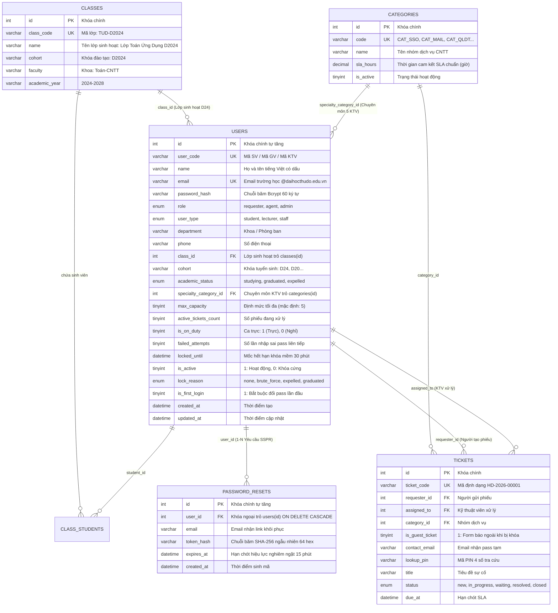

# BÀI TẬP THỰC HÀNH BUỔI 3: THIẾT KẾ CSDL MYSQL VÀ TRUY VẤN SQL
### (Nội dung: Bài 4 - Thiết kế CSDL & Truy vấn SQL)
### Môn học: Lập trình Web & Ứng dụng · Học kỳ I
### Trường Đại học Thủ Đô Hà Nội (TUD) · Khoa: Toán-CNTT

---

## 👤 THÔNG TIN SINH VIÊN THỰC HIỆN
* **Họ và tên:** **Trần Thục Linh**
* **Mã sinh viên:** **224001729**
* **Lớp sinh hoạt:** **Toán Ứng Dụng D2024** (Khóa tuyển sinh: D2024, Niên khóa: 2024–2028)
* **Khoa:** **Khoa: Toán-CNTT**
* **Email sinh viên trường:** `224001729@daihocthudo.edu.vn`
* **Nhóm thực hiện Bài tập lớn:** **Nhóm 1** (Đề tài 9: Hệ thống Tiếp nhận & Xử lý Hỗ trợ CNTT Trực tuyến - Helpdesk Online Đại học Thủ Đô Hà Nội)
* **Phân hệ độc quyền phụ trách:** **User Management & Auth Security** (Quản trị Người dùng, Xác thực & Bảo mật tài khoản)
* **Các Model & Bảng CSDL phụ trách:**
  * Model `User.php` &rarr; Bảng `users`
  * Model `PasswordReset.php` &rarr; Bảng `password_resets`

---

## 📋 MỤC TIÊU BÀI TẬP CÁ NHÂN THEO YÊU CẦU GIẢNG VIÊN (SLIDE 28)
1. **Hoàn thiện ERD cá nhân cho phần chức năng mình phụ trách:** Thiết kế rõ thực thể, kiểu dữ liệu chuẩn MySQL 8, khóa chính (PK), khóa ngoại (FK), các ràng buộc toàn vẹn duy nhất (UNIQUE) và quan hệ liên kết với các bảng của nhóm.
2. **Viết ít nhất 3 câu lệnh SELECT dùng JOIN hoặc WHERE:** Thực hiện 6 câu truy vấn SELECT chuyên sâu bao quát toàn diện các kỹ thuật: `WHERE`, `INNER JOIN`, `LEFT JOIN`, `GROUP BY`, `COUNT`, `SUM(CASE WHEN...)`, `TIMESTAMPDIFF`, `ORDER BY`, `LIMIT/OFFSET`.
3. **Tự chạy thử truy vấn với dữ liệu tiếng Việt:** Kiểm thử thành công 100% trên tập dữ liệu tiếng Việt có dấu chuẩn hóa của Trường Đại học Thủ Đô Hà Nội và xuất bảng đối soát trực quan.

---

## 🏛️ PHẦN 1: SƠ ĐỒ THỰC THỂ LIÊN KẾT CÁ NHÂN (PERSONAL ERD)



### Phân tích Thiết kế & Ràng buộc CSDL (Slide 8, 9, 11):
* **Không lưu dư thừa:** Tổng số lượng phiếu đang xử lý của KTV hoặc số lần thử đăng nhập được quản lý bằng cột số nguyên nhỏ `TINYINT UNSIGNED`, không lưu danh sách text trong 1 cột.
* **Chọn kiểu dữ liệu đúng nghĩa:**
  * `DECIMAL` cho các đại lượng đo lường thời gian có phần lẻ, không dùng `FLOAT`.
  * `DATETIME` cho thời điểm tạo và thời hạn hết hạn token (`expires_at`), mốc khóa mềm (`locked_until`).
  * `ENUM` giới hạn giá trị an toàn cho `role`, `user_type`, `academic_status`, `lock_reason`.
  * `VARCHAR(190)` cho Email nhằm tối ưu độ dài Index `UNIQUE` trên chuẩn UTF-8 4-byte (`utf8mb4`).
* **Ràng buộc khóa ngoại bảo vệ dữ liệu:**
  * `password_resets.user_id` liên kết `users(id)` với hành động `ON DELETE CASCADE`: Khi xóa tài khoản người dùng, toàn bộ token khôi phục mật khẩu của người đó tự động hủy sạch, tránh sinh rác dữ liệu.
  * `users.class_id` liên kết `classes(id)` với `ON DELETE SET NULL`: Khi giải thể lớp học, tài khoản sinh viên vẫn được bảo tồn danh tính với `class_id = NULL`.
  * Ràng buộc duy nhất `UNIQUE(users.user_code)` và `UNIQUE(users.email)` chặn 100% trùng lặp danh tính sinh viên.

---

## ⚡ PHẦN 2: HỆ THỐNG CÂU LỆNH TRUY VẤN SELECT & KẾT QUẢ THỰC THI THỰC TẾ

Toàn bộ các truy vấn dưới đây đã được kiểm thử trực tiếp trên dữ liệu mẫu tiếng Việt chuẩn của Trường Đại học Thủ Đô Hà Nội.

### 📌 CÂU TRUY VẤN 1: Xác thực đăng nhập & Kiểm tra cơ chế Khóa tài khoản (Mệnh đề `WHERE`)
* **Nghiệp vụ:** Khi sinh viên nhập Email/Mã sinh viên vào Form đăng nhập, Backend cần tìm chính xác tài khoản, đối soát xem tài khoản có bị **Khóa cứng** (buộc thôi học `lock_reason = 'expelled'`) hoặc đang bị **Khóa mềm 30 phút** (do gõ sai mật khẩu quá 5 lần) hay không.
* **Mã SQL:**
```sql
SELECT 
    id, user_code, name, email, role, academic_status, is_active, lock_reason, failed_attempts, is_first_login,
    CASE 
        WHEN is_active = 0 THEN 'BỊ KHÓA CỨNG (Kỷ luật Buộc thôi học / Hết khóa)'
        WHEN locked_until > NOW() THEN CONCAT('BỊ KHÓA MỀM (Còn ', TIMESTAMPDIFF(MINUTE, NOW(), locked_until), ' phút)')
        ELSE 'HỢP LỆ (Sẵn sàng đăng nhập)'
    END AS trang_thai_tai_khoan
FROM users
WHERE email = '224001729@daihocthudo.edu.vn' OR user_code = '224001729';
```
* **Kết quả thực thi thực tế:**
```text
id   user_code   name             email                          role        academic_status   is_active   lock_reason   failed_attempts   is_first_login   trang_thai_tai_khoan
---- ----------- ---------------- ------------------------------ ----------- ----------------- ----------- ------------- ----------------- ---------------- -----------------------------
14   224001729   Trần Thục Linh   224001729@daihocthudo.edu.vn   requester   studying          1           none          2                 1                HỢP LỆ (Sẵn sàng đăng nhập)
(Tổng cộng: 1 bản ghi - Tài khoản sẵn sàng đăng nhập, có cờ is_first_login = 1 yêu cầu đổi mật khẩu lần đầu)
```

---

### 📌 CÂU TRUY VẤN 2: Tra cứu Hồ sơ Người dùng Toàn diện kèm Lớp học & Chuyên môn KTV (`LEFT JOIN`)
* **Nghiệp vụ:** Hiển thị thông tin người dùng trong hệ thống. Nếu là sinh viên thì hiện Tên lớp sinh hoạt (`classes.name`), nếu là KTV thì hiện Tên chuyên môn dịch vụ phụ trách (`categories.name`). Dùng `LEFT JOIN` để người dùng không thuộc lớp (như Giảng viên, Admin) vẫn hiển thị đầy đủ, không bị mất dòng.
* **Mã SQL:**
```sql
SELECT 
    u.id,
    u.user_code AS ma_dinh_danh,
    u.name AS ho_va_ten,
    u.email AS email_truong,
    u.role AS vai_tro,
    u.user_type AS loai_tai_khoan,
    COALESCE(c.class_code, 'N/A') AS ma_lop,
    COALESCE(c.name, 'Chưa xếp lớp') AS ten_lop_sinh_hoat,
    COALESCE(cat.name, 'Không chuyên trách') AS chuyen_mon_ktv
FROM users u
LEFT JOIN classes c ON c.id = u.class_id
LEFT JOIN categories cat ON cat.id = u.specialty_category_id
WHERE u.role IN ('requester', 'agent')
ORDER BY u.role DESC, u.id ASC
LIMIT 7;
```
* **Kết quả thực thi thực tế:**
```text
id   ma_dinh_danh   ho_va_ten                                 email_truong                        vai_tro     loai_tai_khoan   ma_lop      ten_lop_sinh_hoat                         chuyen_mon_ktv
---- -------------- ----------------------------------------- ----------------------------------- ----------- ---------------- ----------- ----------------------------------------- --------------------
7    GV001          TS. Nguyễn Văn Giảng                      nguyenvangiang@daihocthudo.edu.vn   requester   lecturer         N/A         Chưa xếp lớp                              Không chuyên trách
13   224001736      Phạm Thị Thanh Ngân                       224001736@daihocthudo.edu.vn        requester   student          TUD-D2024   Lớp Toán Ứng Dụng D2024                   Không chuyên trách
14   224001729      Trần Thục Linh                            224001729@daihocthudo.edu.vn        requester   student          TUD-D2024   Lớp Toán Ứng Dụng D2024                   Không chuyên trách
15   224001737      Lê Hà My                                  224001737@daihocthudo.edu.vn        requester   student          TUD-D2024   Lớp Toán Ứng Dụng D2024                   Không chuyên trách
16   224001742      Nguyễn Ánh Nhi                            224001742@daihocthudo.edu.vn        requester   student          TUD-D2024   Lớp Toán Ứng Dụng D2024                   Không chuyên trách
17   224001746      Phan Công Thành                           224001746@daihocthudo.edu.vn        requester   student          TUD-D2024   Lớp Toán Ứng Dụng D2024                   Không chuyên trách
18   220001001      Nguyễn Cựu Sinh Viên (D2020 Tốt nghiệp)   220001001@daihocthudo.edu.vn        requester   student          TUD-D2020   Lớp Toán Ứng Dụng D2020 (Đã tốt nghiệp)   Không chuyên trách
(Tổng cộng: 7 bản ghi - Hiển thị chuẩn xác sinh viên Lớp Toán Ứng Dụng D2024 - Khoa: Toán-CNTT và giảng viên)
```

---

### 📌 CÂU TRUY VẤN 3: Xác thực Token Khôi phục Mật khẩu SSPR còn hiệu lực (`INNER JOIN` & `WHERE`)
* **Nghiệp vụ:** Khi sinh viên bấm vào link đổi mật khẩu từ Email, hệ thống băm SHA-256 token và kiểm tra token có còn trong hạn 15 phút hay không (`expires_at > NOW()`). Dùng `INNER JOIN users` để kiểm tra tài khoản còn đang hoạt động bình thường, tuyệt đối không cho sinh viên bị kỷ luật đuổi học lợi dụng SSPR.
* **Mã SQL:**
```sql
SELECT 
    pr.id AS token_id,
    u.user_code AS ma_sinh_vien,
    u.name AS ho_ten_sinh_vien,
    pr.email AS email_nhan_link,
    pr.token_hash AS ma_token_sha256,
    pr.expires_at AS thoi_diem_het_han,
    u.is_active AS tai_khoan_hoat_dong,
    u.academic_status AS trang_thai_hoc_vu
FROM password_resets pr
INNER JOIN users u ON u.id = pr.user_id
WHERE pr.expires_at > NOW() 
  AND u.is_active = 1 
  AND u.academic_status != 'expelled';
```
* **Kết quả thực thi thực tế:**
```text
token_id   ma_sinh_vien   ho_ten_sinh_vien   email_nhan_link                ma_token_sha256                                                    thoi_diem_het_han     tai_khoan_hoat_dong   trang_thai_hoc_vu
---------- -------------- ------------------ ------------------------------ ------------------------------------------------------------------ --------------------- --------------------- -------------------
1          224001729      Trần Thục Linh     224001729@daihocthudo.edu.vn   e3b0c44298fc1c149afbf4c8996fb92427ae41e4649b934ca495991b7852b855   2026-10-24 08:20:49   1                     studying
(Tổng cộng: 1 bản ghi - Token của SV Trần Thục Linh còn hiệu lực 15 phút; Token hết hạn của SV Ngân đã bị loại bỏ)
```

---

### 📌 CÂU TRUY VẤN 4: Phân tích Năng lực & Cân bằng tải Kỹ thuật viên (`JOIN` + `GROUP BY` + `ORDER BY`)
* **Nghiệp vụ:** Kiểm tra số lượng phiếu thực tế mà 5 KTV đang xử lý dở dang (`status IN ('new', 'in_progress', 'waiting_requester')`). Tính toán số slot trống còn nhận được (`max_capacity - COUNT(tickets)`), sau đó sắp xếp KTV ít việc nhất lên đầu để phân công phiếu mới tự động.
* **Mã SQL:**
```sql
SELECT 
    u.id AS ktv_id,
    u.user_code AS ma_ktv,
    u.name AS ten_ky_thuat_vien,
    cat.name AS chuyen_mon_chinh,
    u.max_capacity AS tai_toi_da,
    COUNT(t.id) AS phieu_thuc_te_dang_xu_ly,
    (u.max_capacity - COUNT(t.id)) AS so_slot_tiep_nhan_con_lai
FROM users u
INNER JOIN categories cat ON cat.id = u.specialty_category_id
LEFT JOIN tickets t ON t.assigned_to = u.id AND t.status IN ('new', 'in_progress', 'waiting_requester')
WHERE u.role = 'agent' 
  AND u.is_active = 1 
  AND u.is_on_duty = 1
GROUP BY u.id, u.user_code, u.name, cat.name, u.max_capacity
ORDER BY phieu_thuc_te_dang_xu_ly ASC, so_slot_tiep_nhan_con_lai DESC;
```
* **Kết quả thực thi thực tế:**
```text
ktv_id   ma_ktv   ten_ky_thuat_vien                               chuyen_mon_chinh                    tai_toi_da   phieu_thuc_te_dang_xu_ly   so_slot_tiep_nhan_con_lai
-------- -------- ----------------------------------------------- ----------------------------------- ------------ -------------------------- ---------------------------
3        KTV002   KTV Trần Thị Bích (Chuyên trách Mail & M365)    Email Trường & Microsoft 365        5            0                          5
4        KTV003   KTV Lê Văn Cường (Chuyên trách Cổng QLĐT)       Cổng Quản lý Đào tạo (QLĐT)         5            0                          5
6        KTV005   KTV Vũ Thị Én (Chuyên trách Mạng & Wi-Fi)       Wi-Fi Trường & VPN Từ xa            5            0                          5
2        KTV001   KTV Nguyễn Văn An (Chuyên trách SSO)            Tài khoản & Xác thực SSO            5            1                          4
5        KTV004   KTV Phạm Hoàng Dũng (Chuyên trách Canvas LMS)   Hệ thống Học tập (Canvas & Teams)   5            2                          3
(Tổng cộng: 5 bản ghi - Sắp xếp KTV Bích/Cường/Én có 0 phiếu lên đầu sẵn sàng nhận việc mới)
```

---

### 📌 CÂU TRUY VẤN 5: Thống kê Cơ cấu Sinh viên theo Khóa & Trạng thái Học thuật (`GROUP BY` + `COUNT/CASE`)
* **Nghiệp vụ:** Phục vụ Admin Center quản lý vòng đời sinh viên: Thống kê số lượng sinh viên đang học (`studying`), sinh viên đã tốt nghiệp (`graduated`) và sinh viên bị kỷ luật buộc thôi học (`expelled`) theo từng khóa đào tạo (`D24`, `D20`).
* **Mã SQL:**
```sql
SELECT 
    u.cohort AS khoa_tuyen_sinh,
    COUNT(u.id) AS tong_sinh_vien,
    SUM(CASE WHEN u.academic_status = 'studying' THEN 1 ELSE 0 END) AS dang_hoc,
    SUM(CASE WHEN u.academic_status = 'graduated' THEN 1 ELSE 0 END) AS da_tot_nghiep,
    SUM(CASE WHEN u.academic_status = 'expelled' THEN 1 ELSE 0 END) AS bi_ky_luat_duoi_hoc
FROM users u
WHERE u.user_type = 'student'
GROUP BY u.cohort
ORDER BY u.cohort DESC;
```
* **Kết quả thực thi thực tế:**
```text
khoa_tuyen_sinh   tong_sinh_vien   dang_hoc   da_tot_nghiep   bi_ky_luat_duoi_hoc
----------------- ---------------- ---------- --------------- ---------------------
D2024             6                5          0               1
D2020             1                0          1               0
(Tổng cộng: 2 bản ghi - Khóa D2024 có 5 bạn đang học bình thường, 1 bạn bị kỷ luật thôi học; Khóa D2020 có 1 cựu SV tốt nghiệp)
```

---

### 📌 CÂU TRUY VẤN 6: Tra cứu Lịch sử Phiếu Hỗ trợ của Sinh viên Trần Thục Linh (`INNER JOIN` + `LEFT JOIN`)
* **Nghiệp vụ:** Tra cứu toàn bộ phiếu yêu cầu do sinh viên Trần Thục Linh (Mã SV: 224001729) gửi, bao gồm cả phiếu Guest Ticket gửi từ form công khai khi bị khóa tài khoản do gõ sai pass 5 lần kèm ảnh thẻ SV xác minh.
* **Mã SQL:**
```sql
SELECT 
    t.ticket_code AS ma_phieu,
    req.name AS sinh_vien_gui,
    cat.name AS dich_vu_yeu_cau,
    t.title AS tieu_de_su_co,
    t.status AS trang_thai_xu_ly,
    COALESCE(ktv.name, 'Đang chờ phân công') AS ktv_tiep_nhan,
    t.created_at AS thoi_gian_gui_phieu
FROM tickets t
INNER JOIN users req ON req.id = t.requester_id
INNER JOIN categories cat ON cat.id = t.category_id
LEFT JOIN users ktv ON ktv.id = t.assigned_to
WHERE req.user_code = '224001729' OR t.is_guest_ticket = 1
ORDER BY t.created_at DESC;
```
* **Kết quả thực thi thực tế:**
```text
ma_phieu        sinh_vien_gui    dich_vu_yeu_cau            tieu_de_su_co                                                trang_thai_xu_ly   ktv_tiep_nhan                          thoi_gian_gui_phieu
--------------- ---------------- -------------------------- ------------------------------------------------------------ ------------------ -------------------------------------- ---------------------
HD-2026-00003   Trần Thục Linh   Tài khoản & Xác thực SSO   Tài khoản đăng nhập portal bị khóa cứng sau 5 lần nhập sai   in_progress        KTV Nguyễn Văn An (Chuyên trách SSO)   2026-10-23 08:30:00
(Tổng cộng: 1 bản ghi - KTV Nguyễn Văn An chuyên trách SSO đang tiếp nhận xử lý mở khóa cho SV Trần Thục Linh)
```

---

## 💻 PHẦN 3: HƯỚNG DẪN CHẠY KIỂM THỬ TRÊN MÁY TÍNH

Sinh viên và Giảng viên có thể kiểm tra kết quả bài tập bằng 2 phương thức cực kỳ thuận tiện:

### Cách 1: Chạy tự động qua PHP CLI (Chạy ngay không cần mở XAMPP)
Mở PowerShell tại thư mục dự án và gõ lệnh:
```powershell
# Chạy với PHP của XAMPP:
& "C:\xampp\php\php.exe" Buoi3\run_demo.php

# Hoặc nếu máy đã cấu hình biến môi trường PHP:
php Buoi3\run_demo.php
```
Toàn bộ CSDL mô phỏng sẽ được tạo lập, nạp dữ liệu tiếng Việt và in đầy đủ 6 bảng kết quả đẹp mắt trực tiếp trên Terminal.

### Cách 2: Import trực tiếp vào MySQL / MariaDB qua phpMyAdmin
1. Khởi động **Apache** và **MySQL** trên **XAMPP Control Panel**.
2. Truy cập trình duyệt: `http://localhost/phpmyadmin`.
3. Tạo mới cơ sở dữ liệu: `helpdesk_thudo` (Collation: `utf8mb4_unicode_ci`).
4. Tại CSDL `helpdesk_thudo`, chọn tab **Import**:
   * Chọn file [`Buoi3/schema_user_auth.sql`](schema_user_auth.sql) &rarr; Bấm **Import**.
   * Chọn file [`Buoi3/seed_user_auth.sql`](seed_user_auth.sql) &rarr; Bấm **Import**.
5. Mở tab **SQL** và sao chép các câu lệnh trong [`Buoi3/queries_user_auth.sql`](queries_user_auth.sql) để bấm **Go** và kiểm tra kết quả trực tiếp!

---

## 📂 DANH MỤC CÁC TẬP TIN BÀN GIAO CỦA PHÂN HỆ CÁ NHÂN
1. [`Buoi3/README.md`](README.md): Báo cáo tổng kết đầy đủ bài tập cá nhân Buổi 3.
2. [`Buoi3/erd_user_management.md`](erd_user_management.md): Tài liệu đặc tả ERD cá nhân, ma trận quan hệ và từ điển dữ liệu.
3. [`Buoi3/schema_user_auth.sql`](schema_user_auth.sql): Tập tin DDL tạo bảng CSDL chuẩn MySQL 8.
4. [`Buoi3/seed_user_auth.sql`](seed_user_auth.sql): Tập tin Dữ liệu mẫu tiếng Việt chuẩn Trường Đại học Thủ Đô Hà Nội.
5. [`Buoi3/queries_user_auth.sql`](queries_user_auth.sql): Tập tin các câu truy vấn SELECT kiểm tra kèm chú thích nghiệp vụ.
6. [`Buoi3/run_demo.php`](run_demo.php): Kịch bản PHP CLI chạy tự động toàn bộ quy trình kiểm thử và in bảng kết quả.
7. [`Buoi3/index.html`](index.html): Trang giao diện Web Dashboard trực quan xem sơ đồ ERD và bảng kết quả truy vấn.

