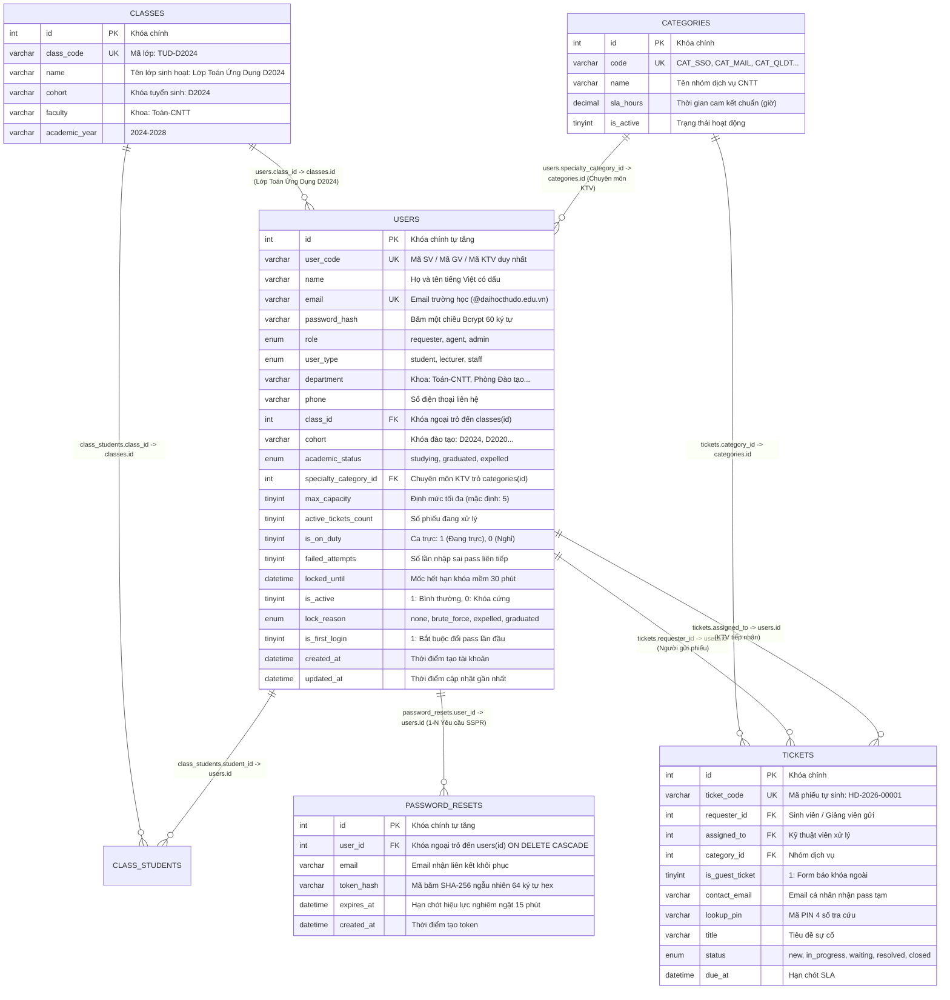

# SƠ ĐỒ THỰC THỂ QUAN HỆ (ERD) & ĐẶC TẢ CƠ SỞ DỮ LIỆU
## PHÂN HỆ: USER MANAGEMENT & AUTH SECURITY
### Sinh viên thực hiện: Trần Thục Linh (Mã SV: 224001729) - Lớp Toán Ứng Dụng D2024
### Khoa: Toán-CNTT · Trường Đại học Thủ Đô Hà Nội
**Hệ thống:** Helpdesk Tiếp nhận & Xử lý Hỗ trợ CNTT Trực tuyến Trường Đại học Thủ Đô Hà Nội  
**Môn học:** Lập trình Web - Bài 4: Thiết kế CSDL MySQL và Truy vấn SQL

---

## 1. SƠ ĐỒ THỰC THỂ QUAN HỆ CÁ NHÂN (PERSONAL ERD)

Dưới đây là sơ đồ Mermaid ERD chuẩn trực quan mô tả 2 thực thể trung tâm do **Trần Thục Linh** độc quyền phụ trách (`users`, `password_resets`) và mối liên kết logic với các thực thể liên quan (`classes`, `categories`, `tickets`, `class_students`):

---

## 2. QUAN HỆ GIỮA CÁC THỰC THỂ & BẢN SỐ (CARDINALITY)

| Cặp thực thể | Bản số | Bản chất quan hệ nghiệp vụ | Ràng buộc bảo vệ |
|---|:---:|---|---|
| **`users` (1) &rarr; `password_resets` (N)** | $1 - N$ | Một người dùng có thể yêu cầu đổi mật khẩu nhiều lần theo thời gian; mỗi bản ghi reset thuộc về đúng 1 người dùng. | `FOREIGN KEY (user_id) REFERENCES users(id) ON DELETE CASCADE`. Khi người dùng bị xóa, toàn bộ token của họ tự động hủy. |
| **`classes` (1) &rarr; `users` (N)** | $1 - N$ | Một lớp sinh hoạt (ví dụ: `TUD-D2024` - Lớp Toán Ứng Dụng D2024) gồm nhiều sinh viên. Người dùng là cán bộ/giảng viên/admin có thể có `class_id = NULL`. | `FOREIGN KEY (class_id) REFERENCES classes(id) ON DELETE SET NULL`. |
| **`categories` (1) &rarr; `users` (N)** | $1 - N$ | Một chuyên môn dịch vụ CNTT (CAT_SSO, CAT_MAIL, CAT_CANVAS...) có nhiều KTV phụ trách theo kỹ năng. | `FOREIGN KEY (specialty_category_id) REFERENCES categories(id) ON DELETE SET NULL`. |
| **`users` (1) &rarr; `tickets` (N) [requester]** | $1 - N$ | Một sinh viên hoặc giảng viên có thể tạo nhiều phiếu yêu cầu hỗ trợ kỹ thuật khác nhau theo thời gian. | `FOREIGN KEY (requester_id) REFERENCES users(id) ON DELETE CASCADE`. |
| **`users` (1) &rarr; `tickets` (N) [assigned_to]** | $1 - N$ | Một KTV tiếp nhận và xử lý nhiều phiếu, nhưng bị giới hạn bởi định mức tối đa `active_tickets_count <= max_capacity` (5 phiếu). | `FOREIGN KEY (assigned_to) REFERENCES users(id) ON DELETE SET NULL`. |

---

## 3. TỪ ĐIỂN DỮ LIỆU CHI TIẾT (DATA DICTIONARY)

### A. Bảng `users` (Tài khoản người dùng toàn trường)
* **Ý nghĩa:** Quản trị danh tính, xác thực tập trung, phân quyền RBAC và kiểm soát vòng đời học thuật (Đầu kỳ import, giữa kỳ học tập, cuối kỳ tốt nghiệp/kỷ luật).
* **Động cơ lưu trữ:** `InnoDB`, bảng mã ký tự: `utf8mb4`, Collation: `utf8mb4_unicode_ci`.

| Tên Cột | Kiểu Dữ Liệu | Ràng buộc & Chỉ mục | Mặc định | Giải thích Nghiệp vụ chi tiết |
|---|---|---|---|---|
| `id` | `INT UNSIGNED` | `PRIMARY KEY, AUTO_INCREMENT` | Tự tăng | Định danh duy nhất của mỗi tài khoản |
| `user_code` | `VARCHAR(30)` | `NOT NULL, UNIQUE` | Không | Mã định danh sinh viên (`224001729`), giảng viên (`GV001`) hoặc KTV (`KTV001`) |
| `name` | `VARCHAR(100)` | `NOT NULL` | Không | Họ và tên đầy đủ bằng tiếng Việt có dấu |
| `email` | `VARCHAR(190)` | `NOT NULL, UNIQUE` | Không | Địa chỉ email trường học cấp: `... @daihocthudo.edu.vn` |
| `password_hash` | `VARCHAR(255)` | `NOT NULL` | Không | Chuỗi băm mật khẩu chuẩn Bcrypt 60 ký tự (`$2y$10$...`), mặc định khởi tạo là `123456` |
| `role` | `ENUM('requester','agent','admin')` | `NOT NULL` | `'requester'` | Quyền hạn trong hệ thống theo mô hình RBAC |
| `user_type` | `ENUM('student','lecturer','staff')` | `NOT NULL` | `'student'` | Phân loại đối tượng người dùng |
| `department` | `VARCHAR(100)` | `NULL` | `NULL` | Phòng ban/Khoa công tác (Khoa: Toán-CNTT...) |
| `phone` | `VARCHAR(20)` | `NULL` | `NULL` | Số điện thoại liên lạc khi có sự cố khẩn cấp |
| `class_id` | `INT UNSIGNED` | `NULL, FK -> classes(id)` | `NULL` | Lớp sinh hoạt chính đối với sinh viên |
| `cohort` | `VARCHAR(20)` | `NULL` | `'D2024'` | Khóa tuyển sinh: `D2024` (sinh viên TUD), `D2020` (Admin lọc chuyển tốt nghiệp) |
| `academic_status` | `ENUM('studying','graduated','expelled','suspended')` | `NOT NULL` | `'studying'` | Trạng thái học thuật: Đang học, Đã tốt nghiệp, hoặc Bị kỷ luật buộc thôi học |
| `specialty_category_id` | `INT UNSIGNED` | `NULL, FK -> categories(id)` | `NULL` | Nhóm sự cố chuyên sâu của KTV (1 đến 5) |
| `max_capacity` | `TINYINT UNSIGNED` | `NOT NULL` | `5` | Định mức tiếp nhận tối đa số phiếu cùng một lúc |
| `active_tickets_count` | `TINYINT UNSIGNED` | `NOT NULL` | `0` | Bộ đếm nguyên tử số phiếu đang xử lý phục vụ cân bằng tải |
| `is_on_duty` | `TINYINT(1)` | `NOT NULL` | `1` | Ca trực KTV: 1 (Đang trong ca trực), 0 (Nghỉ ca) |
| `failed_attempts` | `TINYINT UNSIGNED` | `NOT NULL` | `0` | Số lần gõ sai mật khẩu liên tiếp (chống dò Brute-force) |
| `locked_until` | `DATETIME` | `NULL` | `NULL` | Mốc thời gian hết hạn Khóa mềm 30 phút khi nhập sai 5 lần |
| `is_active` | `TINYINT(1)` | `NOT NULL` | `1` | 1: Tài khoản mở bình thường; 0: Tài khoản bị Khóa cứng |
| `lock_reason` | `ENUM('none','brute_force','violation','expelled','tuition_debt','graduated')` | `NOT NULL` | `'none'` | Lý do khóa tài khoản (phục vụ đối soát và hiển thị thông báo) |
| `is_first_login` | `TINYINT(1)` | `NOT NULL` | `1` | 1: Bắt buộc đổi mật khẩu ở lần đăng nhập đầu tiên |
| `created_at` | `DATETIME` | `NOT NULL` | `CURRENT_TIMESTAMP` | Thời điểm tạo tài khoản |
| `updated_at` | `DATETIME` | `NOT NULL` | `CURRENT_TIMESTAMP ON UPDATE` | Thời điểm cập nhật dữ liệu gần nhất |

### B. Bảng `password_resets` (Khôi phục mật khẩu tự phục vụ qua Email - SSPR)
* **Ý nghĩa:** Quản lý quy trình Tự phục vụ cấp lại mật khẩu (Self-Service Password Reset - SSPR) hoàn toàn tự động, sinh token ngẫu nhiên và kiểm soát thời gian sống chặt chẽ.
* **Thời hạn hiệu lực:** Đúng **15 phút** kể từ thời điểm gửi email.

| Tên Cột | Kiểu Dữ Liệu | Ràng buộc & Chỉ mục | Mặc định | Giải thích Nghiệp vụ chi tiết |
|---|---|---|---|---|
| `id` | `INT UNSIGNED` | `PRIMARY KEY, AUTO_INCREMENT` | Tự tăng | Định danh bản ghi reset |
| `user_id` | `INT UNSIGNED` | `NOT NULL, FK -> users(id)` | Không | Người dùng gửi yêu cầu đặt lại mật khẩu |
| `email` | `VARCHAR(190)` | `NOT NULL` | Không | Địa chỉ email tiếp nhận đường dẫn khôi phục |
| `token_hash` | `VARCHAR(64)` | `NOT NULL, INDEX` | Không | Chuỗi băm SHA-256 của token bảo mật 64 ký tự hex ngẫu nhiên |
| `expires_at` | `DATETIME` | `NOT NULL, INDEX` | Không | Thời điểm hết hạn token (`NOW() + 15 phút`) |
| `created_at` | `DATETIME` | `NOT NULL` | `CURRENT_TIMESTAMP` | Thời điểm sinh mã token |

---

## 4. CÁC RÀNG BUỘC TOÀN VẸN & BẢO VỆ DỮ LIỆU Ở TẦNG CSDL

Theo tinh thần Bài 4 (*"Ràng buộc CSDL không thay thế validation trong PHP, nhưng giúp chặn lỗi ở lớp dữ liệu"*), phân hệ thiết lập các chốt chặn nghiêm ngặt:

1. **Ràng buộc Khóa chính & Tự tăng (`PRIMARY KEY, AUTO_INCREMENT`):**
   - Đảm bảo mỗi dòng dữ liệu người dùng và token reset có định danh duy nhất tuyệt đối.
2. **Ràng buộc Duy nhất (`UNIQUE KEY`):**
   - `uq_users_user_code`: Ngăn chặn 100% trùng lặp mã sinh viên hoặc mã cán bộ.
   - `uq_users_email`: Đảm bảo 1 email trường chỉ thuộc về đúng 1 người dùng duy nhất.
3. **Ràng buộc Khóa ngoại & Hành động tầng cha (`FOREIGN KEY ... ON DELETE`):**
   - `fk_password_resets_user`: Sử dụng `ON DELETE CASCADE` &rarr; Khi xóa tài khoản người dùng, toàn bộ token khôi phục liên quan bị xóa ngay lập tức, không để lại rác dữ liệu.
   - `fk_users_class`: Sử dụng `ON DELETE SET NULL` &rarr; Nếu một lớp sinh hoạt bị xóa/chia tách, tài khoản sinh viên vẫn tồn tại an toàn với `class_id = NULL`.
4. **Bảo vệ Vòng đời Sinh viên & Chống Vượt rào SSPR:**
   - Khi tài khoản sinh viên bị kỷ luật thôi học (`lock_reason = 'expelled'`, `is_active = 0`), câu truy vấn xác thực SSPR kiểm tra kết hợp `users.is_active = 1` và `academic_status != 'expelled'` &rarr; Loại bỏ hoàn toàn nguy cơ sinh viên bị kỷ luật lợi dụng tính năng quên mật khẩu để tự mở tài khoản!
5. **Chỉ mục tối ưu hiệu năng (Database Indexes):**
   - `idx_agent_dispatch (role, is_active, is_on_duty, specialty_category_id, active_tickets_count)`: Tăng tốc cực đại thuật toán cân bằng tải KTV mà không cần quét toàn bộ bảng.
   - `idx_token_lookup (token_hash, expires_at)`: Tối ưu tra cứu token SSPR với độ phức tạp $O(\log N)$.
   - `idx_user_lookup (user_code, user_type, academic_status)`: Phục vụ xác thực đăng nhập tức thì.

